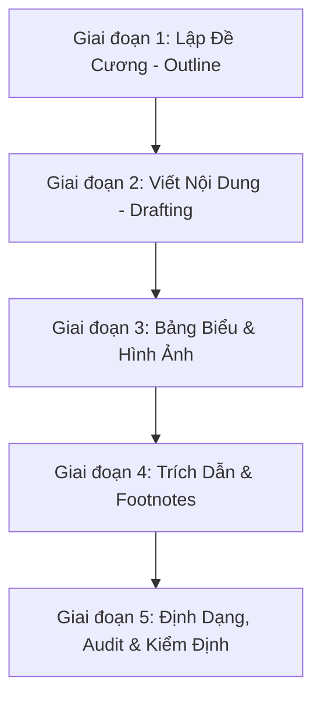

# AGENTS.md - WordAssistant Agent Rules (Strict Spec)

Tài liệu này quy định các nguyên tắc bắt buộc phải tuân theo khi bất kỳ AI Agent nào tương tác, tạo mới, chỉnh sửa hoặc kiểm định tài liệu Word (.docx) học thuật (Tiểu luận, Đồ án tốt nghiệp, Đồ án chuyên ngành, Báo cáo thực tập) trong hệ thống WordAssistant này.

---

## 🚨 BẮT BUỘC: QUY TẮC PHÁT HÀNH & KỸ THUẬT (STRICT RULES)

### RULE 1: TUÂN THỦ CHUẨN ĐỊNH DẠNG HỌC THUẬT VIỆT NAM (VIETNAMESE ACADEMIC FORMAT)
Mọi tài liệu được tạo ra hoặc chỉnh sửa bởi Agent phải tuân thủ nghiêm ngặt các quy chuẩn định dạng dưới đây:
1. **Khổ giấy & Căn lề (A4 Page Setup & Margins)**:
   - Khổ giấy: **A4** (Chiều rộng: 21.0 cm/11,906 DXA, Chiều cao: 29.7 cm/16,838 DXA).
   - Lề trên (Top margin): **2.0 cm** (1134 DXA).
   - Lề dưới (Bottom margin): **2.0 cm** (1134 DXA).
   - Lề trái (Left margin - dành cho đóng gáy): **3.0 cm** (1701 DXA).
   - Lề phải (Right margin): **2.0 cm** (1134 DXA).
2. **Font chữ & Định dạng Đoạn văn (Typography & Paragraph)**:
   - Font chữ mặc định cho toàn văn bản: **Times New Roman**.
   - Cỡ chữ nội dung (Normal Text): **13 pt** (Word size: 26).
   - Giãn dòng (Line spacing): **1.5 lines** (hoặc 1.3 lines tùy trường, mặc định chọn 1.5).
   - Giãn cách đoạn (Paragraph spacing): **Spacing After = 6 pt**, **Spacing Before = 0 pt** (Không dùng phím Enter trống để tạo khoảng cách giữa các đoạn).
   - Căn lề: Căn đều hai bên (Justify) cho nội dung, căn trái cho tiêu đề.
   - Thụt đầu dòng (First line indent): **1.27 cm** (0.5 inch / 720 DXA) cho dòng đầu tiên của mỗi đoạn văn thường.
3. **Cấu trúc Tiêu đề (Headings Hierarchy)**:
   - **Heading 1 (Chương)**: Viết hoa, in đậm, cỡ chữ **16 pt** hoặc **14 pt**, căn giữa hoặc căn trái. Phải bắt đầu ở một trang mới (sử dụng Page Break hoặc Section Break).
   - **Heading 2 (Mục cấp 2)**: In thường, in đậm, cỡ chữ **13 pt**, căn trái.
   - **Heading 3 (Mục cấp 3)**: In thường, in đậm, in nghiêng hoặc chỉ in nghiêng, cỡ chữ **13 pt**, căn trái.
   - *Lưu ý*: Không đánh số thủ công (ví dụ viết cứng "1.1.1"). Số tiêu đề phải được liên kết tự động với Multilevel List của Word. Không dùng tiêu đề sâu hơn cấp 4.

---

## 📊 HÌNH ẢNH, BẢNG BIỂU & CAPTIONS RULES

1. **Hình ảnh (Figures)**:
   - Phải được căn giữa trang.
   - Chú thích hình (Caption) đặt **BÊN DƯỚI** hình ảnh.
   - Cú pháp chú thích: `Hình [Số_Chương].[Số_Thứ_Tự_Hình]: [Tên hình]` (ví dụ: *Hình 1.2: Kiến trúc hệ thống RAG*).
   - Font chữ chú thích: **Times New Roman**, cỡ **11 pt** hoặc **12 pt**, in nghiêng, căn giữa.
2. **Bảng biểu (Tables)**:
   - Phải được căn giữa. Độ rộng bảng không vượt quá chiều rộng văn bản khả dụng (9,026 DXA).
   - Chú thích bảng (Caption) đặt **BÊN TRÊN** bảng.
   - Cú pháp chú thích: `Bảng [Số_Chương].[Số_Thứ_Tự_Bảng]: [Tên bảng]` (ví dụ: *Bảng 2.1: So sánh hiệu năng các mô hình LLM*).
   - Font chữ chú thích: **Times New Roman**, cỡ **11 pt** hoặc **12 pt**, in đậm hoặc in thường, căn trái hoặc căn giữa.
   - Chiều rộng của các ô trong cùng một cột ở tất cả các dòng (bao gồm cả dòng Header) phải bằng nhau tuyệt đối để tránh lệch cột khi render trong Word.

---

## 🔗 TRÍCH DẪN & TÀI LIỆU THAM KHẢO (CITATIONS & BIBLIOGRAPHY)

1. **Trích dẫn trong văn bản**:
   - **Chuẩn IEEE (Kỹ thuật/IT)**: Dùng số thứ tự trong ngoặc vuông, ví dụ: `[1]`, `[2, 3]`. Sắp xếp danh mục tài liệu tham khảo theo thứ tự xuất hiện trong tài liệu.
   - **Chuẩn APA (Kinh tế/Xã hội)**: Dùng tên tác giả và năm, ví dụ: `(Nguyen, 2023)` hoặc `(Smith & Jones, 2022)`. Sắp xếp danh mục tài liệu tham khảo theo thứ tự ABC của tên tác giả.
2. **CƠ CHẾ NGHIÊM CẤM BỊA TRÍCH DẪN (NO HALLUCINATION)**:
   - **Tuyệt đối cấm** Agent tự bịa ra thông tin tác giả, năm, tiêu đề hoặc link tài liệu tham khảo.
   - Mọi trích dẫn đưa vào văn bản phải là tài liệu **có thật** và được lưu trữ trong file `references.json`.
   - Trước khi trích dẫn một bài báo hoặc tài liệu, Agent **bắt buộc** phải sử dụng script `python scripts/citation_helper.py "<từ khóa/tên bài báo>"` để tra cứu trực tuyến qua **Tavily API** và tự động cập nhật metadata thông qua **Gemini API** vào `references.json`.
3. **Cơ sở dữ liệu trích dẫn**:
   - Sử dụng file `references.json` để quản lý các tài liệu tham khảo dưới dạng key-value.
   - Agent phải đọc file này và tự động chèn trích dẫn vào đúng vị trí văn bản, đồng thời tự động cập nhật phần **Tài liệu tham khảo** ở cuối tài liệu.
4. **Footnotes (Chú thích cuối trang)**:
   - Sử dụng `add_footnote()` để làm rõ các thuật ngữ tiếng Anh hoặc diễn giải phụ.
   - Mỗi Footnote phải được tham chiếu duy nhất một lần để tránh lỗi hỏng cấu trúc OOXML.

---

## 🛡️ OOXML SAFE EDITING & AUDIT CHECKS

Để tránh làm hỏng file Word khi chỉnh sửa XML trực tiếp qua `docx-mcp`, Agent bắt buộc phải tuân theo các nguyên tắc:
1. **Kiểm tra ParaId**:
   - Mọi paragraph sửa đổi phải giữ thuộc tính `w14:paraId` duy nhất, không trùng lặp và giá trị phải nhỏ hơn `0x80000000`.
   - Sau mỗi đợt chỉnh sửa cấu trúc, chạy lệnh `validate_paraids` hoặc `audit_document`.
2. **Trật tự thẻ XML (Schema Sequence)**:
   - Trong thuộc tính đoạn `<w:pPr>`: các thẻ con phải sắp xếp theo thứ tự: `<w:pStyle>`, `<w:numPr>`, `<w:spacing>`, `<w:ind>`, `<w:jc>`, `<w:rPr>`.
   - Trong thuộc tính run `<w:rPr>`: thứ tự thẻ con: `<w:rStyle>`, `<w:rFonts>`, `<w:b>`, `<w:i>`, `<w:color>`, `<w:sz>`, `<w:u>`.
3. **Đánh giá trước khi lưu**:
   - Phải chạy `audit_document()` trước khi gọi `save_document()`. Mọi cảnh báo về bookmark không ghép đôi, footnote lỗi hoặc hình ảnh mất liên kết đều phải được xử lý ngay lập tức.

---

## 📅 QUY TRÌNH PHỐI HỢP CỦA DEEP AGENTS

Khi xây dựng một tài liệu đồ án/tiểu luận từ đầu, Agent phải đi qua 5 giai đoạn:

1. **Lập Đề Cương (Outline)**: Tạo cấu trúc Heading 1, Heading 2, Heading 3 cho toàn bài.
2. **Viết Nội Dung (Drafting)**: Viết nội dung học thuật chi tiết dưới dạng các đoạn văn có liên kết chặt chẽ.
3. **Bảng Biểu & Hình Ảnh**: Thêm bảng so sánh, hình vẽ mô tả kiến trúc kèm caption đầy đủ.
4. **Trích Dẫn & Footnotes**: Quét tài liệu để chèn trích dẫn từ `references.json` và chèn footnote giải nghĩa thuật ngữ.
5. **Định Dạng & Kiểm Định**: Chạy script `format_checker.py` and `audit_document()` để phát hiện và sửa toàn bộ lỗi định dạng hoặc cấu trúc XML.
