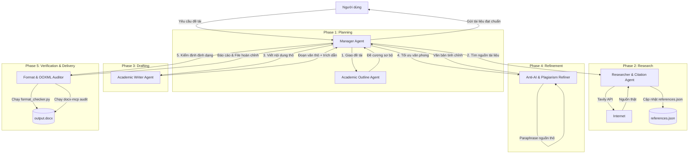

# WordAssistant - Deep Agents System Architecture

Tài liệu này đặc tả kiến trúc hệ thống, quy trình hoạt động (workflow) và các công nghệ cốt lõi được sử dụng để xây dựng **WordAssistant Deep Agents System** - hệ thống Multi-Agent có khả năng tạo và chỉnh sửa tài liệu học thuật đạt chuẩn Việt Nam, đồng thời tối ưu hóa việc chống đạo văn (Plagiarism) và vượt qua các bộ lọc phát hiện AI (AI Detectors như Turnitin, GPTZero).

---

## 1. Hệ Thống Multi-Agent & Workflow (Architecture)

Hệ thống được thiết kế theo mô hình **Orchestrator-Workers Workflow** (Điều phối và Thực thi), trong đó **Manager Agent** đóng vai trò điều phối chính, kiểm soát chất lượng qua từng chặng và luân chuyển tài liệu qua các Agent chuyên biệt.

### Các Agent trong hệ thống:
1. **Manager Agent (Orchestrator)**:
   - Giao tiếp với người dùng và quản lý tiến trình.
   - Kiểm tra chất lượng đầu ra của từng Agent trước khi chuyển sang bước tiếp theo.
2. **Academic Outline Agent (Planner)**:
   - Chịu trách nhiệm thiết kế cấu trúc chương mục hợp lý dựa trên loại tài liệu (tiểu luận, đồ án chuyên ngành, đồ án tốt nghiệp) và đề tài cụ thể.
   - Đảm bảo trật tự Heading khoa học và tự động chèn ngắt trang hợp lý.
3. **Researcher & Citation Agent**:
   - Sử dụng **Tavily Search API** để truy vấn thông tin học thuật thực tế từ arXiv, Google Scholar, ResearchGate.
   - Sử dụng **Gemini API** để trích xuất metadata chuẩn xác và tự động ghi vào `references.json`, loại bỏ hoàn toàn lỗi bịa trích dẫn (hallucination).
4. **Academic Writer Agent**:
   - Nhận thông tin đề cương và tài liệu tham khảo để viết nội dung thô cho từng phần.
   - Chèn các mã trích dẫn tương ứng (ví dụ: `[@cite_key]`).
5. **Anti-AI & Plagiarism Refiner Agent**:
   - Tinh chỉnh văn bản thô để vượt qua Turnitin AI Detector và bộ lọc đạo văn (xem chi tiết ở mục 2 và 3).
6. **Format & OOXML Auditor Agent**:
   - Chạy kiểm định format tự động bằng `format_checker.py` và audit cấu trúc tệp XML bằng `docx-mcp` để tránh lỗi hư hỏng tài liệu.

---

## 2. Giải Pháp Chống Phát Hiện AI (Anti-AI Detection)

Các bộ lọc phát hiện AI (như Turnitin AI Detector, GPTZero) đánh giá văn bản dựa trên hai chỉ số toán học chính: **Perplexity** (Độ phức tạp từ vựng) và **Burstiness** (Độ biến thiên cấu trúc câu). **Refiner Agent** sẽ tối ưu hóa văn bản dựa trên các chiến lược sau:

### A. Tối ưu hóa Burstiness (Độ biến thiên của câu)
AI thường tạo ra các câu có độ dài và cấu trúc ngữ pháp đồng đều, tạo ra nhịp điệu phẳng.
* **Chiến lược**: Refiner Agent sẽ chủ động tái cấu trúc văn bản để xen kẽ giữa các câu đơn cực kỳ ngắn, trực diện (5-10 từ) và các câu phức hợp dài (25-35 từ) chứa nhiều vế phụ câu ghép.
* **Nguyên tắc**: Trong một đoạn văn, chiều dài câu phải có độ lệch chuẩn cao (mức độ biến động chiều dài câu > 10 từ).

### B. Tối ưu hóa Perplexity (Độ phức tạp từ vựng)
AI có xu hướng chọn những từ có xác suất xuất hiện cao nhất (mô hình dự đoán từ tiếp theo), dẫn đến văn phong quá chung chung và dễ đoán.
* **Chiến lược**: Thay thế các từ vựng phổ biến bằng các thuật ngữ chuyên ngành sâu sắc, chính xác, hoặc các từ đồng nghĩa phong phú hơn trong văn cảnh.
* **Nguyên tắc**: Sử dụng các từ vựng đặc thù của ngành học thay vì từ ngữ phổ thông.

### C. Triệt tiêu các dấu hiệu đặc trưng của AI (AI-isms)
Loại bỏ hoàn toàn các từ và mẫu câu sáo rỗng mà mô hình ngôn ngữ lớn (LLM) thường dùng trong tiếng Việt:
* *Cụm từ chuyển ý lặp lại*: "Tóm lại", "Hơn thế nữa", "Hành trình", "Chìa khóa", "Đóng vai trò quan trọng", "Không thể phủ nhận".
* *Văn phong*: Tránh lối viết kết luận quá rập khuôn, luôn tóm tắt vấn đề ở cuối mỗi đoạn một cách máy móc.

---

## 3. Giải Pháp Phòng Chống Đạo Văn (Plagiarism Prevention)

Bộ lọc đạo văn Turnitin đối chiếu chuỗi ký tự trực tiếp với kho dữ liệu khổng lồ. Để ngăn chặn vấn đề này:

### A. Quy trình Paraphrasing (Diễn giải lại) Tự Động
* Khi **Researcher Agent** lấy dữ liệu từ kết quả tìm kiếm Tavily, **Writer Agent** không được phép sao chép nguyên văn.
* **Refiner Agent** có nhiệm vụ viết lại hoàn toàn các ý tưởng đó:
  - Thay đổi cấu trúc câu (chuyển từ chủ động sang bị động và ngược lại).
  - Thay đổi trật tự trình bày thông tin nhưng vẫn bảo toàn bản chất khoa học.
  - Sử dụng các sơ đồ khái niệm hoặc bảng biểu để biểu diễn lại dữ liệu thay vì văn bản thô.

### B. Trích dẫn nguồn triệt để (Proper Citations)
* Mọi số liệu, định lý, khái niệm không do tác giả tự phát triển bắt buộc phải gắn mã trích dẫn `[@cite_key]`.
* Trong hệ thống Turnitin, các phần văn bản nằm trong ngoặc kép hoặc danh mục tài liệu tham khảo được cấu hình đúng chuẩn (IEEE/APA) sẽ được tự động loại trừ khỏi chỉ số đạo văn (Similarity Index). Do đó, việc tự động hóa chèn trích dẫn và tài liệu tham khảo chuẩn xác của `markdown_to_docx.py` đóng vai trò tối quan trọng.

---

## 4. Công Nghệ & Thành Phần Kỹ Thuật (Tech Stack)

* **Lõi điều phối (Orchestration)**: AI Agent (Antigravity/Gemini) điều khiển thông qua cấu trúc prompt và Skills.
* **LLM Engine**: `gemini-2.5-flash` (được cấu hình qua `.env`) để xử lý văn bản, lập luận và tạo nội dung nhờ tốc độ nhanh, chi phí tối ưu và dung lượng ngữ cảnh lớn (1M tokens).
* **Search Engine**: **Tavily Search API** (lọc tên miền học thuật: arxiv, scholar, ieee, researchgate) giúp thu thập kiến thức khoa học thật.
* **Document Engine**: **docx-mcp** (MCP Server cục bộ) để thao tác XML cấu trúc cấp thấp, chèn comment phản biện, gộp tài liệu, so sánh tài liệu, và thực hiện tracked changes.
* **Validation & Auditing**: Python scripts (`format_checker.py`, `markdown_to_docx.py`, `docx_diff.py`, `docx_merge.py`) sử dụng thư viện `python-docx` và `lxml`.
