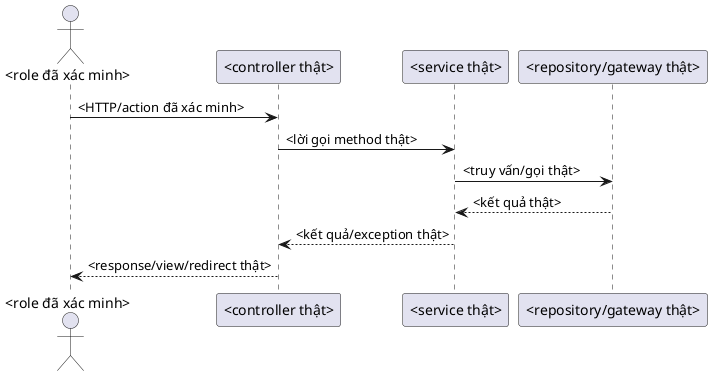

# Quy trình báo cáo theo môn học và project

Tài liệu này là quy trình dùng chung từ lúc nhận đề đến khi bàn giao DOCX. Độ sâu, đề mục, hình và bảng được xác định theo đề, rubric, profile được chọn và bằng chứng của project. Không giảm độ sâu vì tên loại bài, không áp mô hình phần mềm cho môn khác. Mọi yêu cầu cần có vị trí và cách kiểm tra; mục không áp dụng cần lý do. Chỉ mở bài mẫu khi người dùng chỉ định hoặc nguồn yêu cầu dẫn tới nó. Bài mẫu hỗ trợ xem cách trình bày, không quyết định sự thật hay số lượng nội dung của bài mới.

## Bắt đầu hoặc tiếp tục: brief đang có hiệu lực

Mỗi workspace có một `task-brief.md` ngắn làm điểm vào cho công việc đang chạy. Nó là bản tóm tắt trạng thái, không thay đề/rubric, hướng dẫn trình bày, source project, `project.json` hay các ma trận chứng cứ.

- Trước lần sửa đầu tiên, điền brief từ yêu cầu trực tiếp của người dùng và tài liệu authority hiện có. Ghi rõ tiêu chí định dạng, cấu trúc, loại ảnh (runtime, saved capture hay wireframe), phạm vi ảnh cần có, các điều cấm, đường dẫn/hash input và output, trạng thái QA mới nhất và blocker.
- Khi người dùng sửa/bổ sung yêu cầu, cập nhật brief trước thao tác DOCX tiếp theo; đánh dấu yêu cầu cũ là `SUPERSEDED` nếu nó mâu thuẫn. Dùng thứ tự authority đã nêu ở mục 1. Không để tiêu chí quan trọng chỉ tồn tại trong lịch sử chat.
- Khi tiếp tục việc cũ, đọc `task-brief.md`, `project.json`, inventory ngắn của đúng DOCX hiện tại, và QA mới nhất có hash khớp DOCX. Chỉ truy xuất thêm đoạn tài liệu, trang render, log hoặc lịch sử khi cần xử lý một câu hỏi cụ thể. Không nạp toàn bộ DOCX dài hay mọi phiên bản QA vào ngữ cảnh.
- Trước khi sửa, đối chiếu brief với `project.json`, structure/asset matrices và đúng output hiện tại. Nếu khác nhau, dừng chỉnh sửa để đồng bộ các trạng thái trước. Mỗi vòng sửa phải nêu rõ delta so với brief và cổng nào bị vô hiệu; không chạy lại các phần không bị ảnh hưởng.
- Chỉ có một output được `project.json` trỏ là bản đang xét. Mọi QA phải gắn cùng đường dẫn/hash đó; report mang hash khác chỉ là lịch sử, không được dùng để chứng nhận bản hiện tại. Sau khi hoàn tất, ghi lại hash, QA, blocker và bước tiếp theo trong brief.

Brief nên gói gọn trong một màn hình; liên kết đến ma trận và report thay vì chép chúng. Mẫu nằm ở `templates/course-essay-starter/task-brief.md`.

## Sơ đồ luồng

```text
Đề bài + rubric + project nguồn
  → khóa phạm vi và nguồn chuẩn
  → khởi tạo workspace + manifest
  → lập acceptance crosswalk và khóa tiêu chí trước khi sửa
  → kiểm chứng nội dung và route/template
  → lập figure/diagram plan
  → sinh wireframe + cây màn hình / vẽ UML từ source
  → soạn và định dạng DOCX bằng WordAssistant
  → cập nhật field trong Word, lưu bản mới
  → render mọi trang + xem bằng mắt + kiểm tra nội dung
  → lưu báo cáo QA và bàn giao đúng một bản final
```

Mỗi thay đổi DOCX sau khi render làm hết hiệu lực kết quả xem trang trước đó. Chạy lại render và xem lại các trang bị ảnh hưởng; với thay đổi cuối cùng, kiểm tra lại toàn bộ tài liệu.

## Bảng thứ tự, công cụ và đầu ra

| Bước | Công cụ | Đầu vào | Đầu ra / cổng qua bước |
|---|---|---|---|
| 0. Bắt đầu / tiếp tục | `task-brief.md`, `project.json`, DOCX và QA mới nhất có hash khớp | Yêu cầu hiện tại, authority, output đang xét | Brief cập nhật; mọi khác biệt về scope, file hoặc hash được giải quyết trước khi sửa |
| 1. Khóa nguồn và phân loại | Đọc đề/rubric, yêu cầu người dùng, profile được chọn và source project; bài mẫu chỉ khi được chỉ định | Loại tài liệu, tên môn/chương trình, supervisor, cover fields, report mẫu, source root | `project.json` ghi `document_type`, authority từng metadata, revision và profile; mâu thuẫn được đánh dấu BLOCKED |
| 2. Tạo workspace | `scripts/init_course_essay_project.py` | Tên bài đã xác minh và đường dẫn chưa tồn tại | `project.json`, `cover-metadata.csv`, ma trận cấu trúc/hình-bảng rỗng để lập theo bài, requirements/evidence/figure/diagram plans |
| 2a. Khóa acceptance | `acceptance-crosswalk.csv`, task brief, đề/hướng dẫn/rubric | Yêu cầu trực tiếp và từng tiêu chí áp dụng | Mỗi tiêu chí có authority/location, vị trí trong bài, cách kiểm, evidence, reviewer/date và hash DOCX cuối; đủ category bắt buộc trước khi bàn giao |
| 3. Kiểm tra môi trường | WordAssistant `doctor`, `capabilities`; PlantUML `doctor` nếu vẽ UML | Repo và máy hiện tại | JSON xác nhận backend thật sự hoạt động; năng lực thiếu được đánh dấu `NOT RUN` |
| 4. Lập chứng cứ | Đọc đúng controller, template, service/entity, rubric và nguồn trích dẫn liên quan | Manifest và source project chỉ đọc | Mỗi phát biểu/hình có file, symbol, route hoặc đoạn nguồn để kiểm lại |
| 5. Sinh wireframe và cây màn hình | `scripts/build_course_essay_assets.py build` cho Java Spring MVC có scanner; `render` cho framework khác sau khi người review kiểm source | `screen-inventory.json` đã đối chiếu với source | PNG wireframe, PNG cây phân rã, `.puml` cây, JSON report. `build` có thể báo scanner `PASS`; `render` báo `source_verification=NOT_RUN_MANUAL_REVIEW_REQUIRED` và không xác nhận route |
| 6. Vẽ UML chuyên môn | Viết `.puml` từ source rồi dùng `wordassistant plantuml render` | Bảng `diagram-plan.csv`, source code đã xác minh | `.puml` có thể sửa, PNG để đưa vào Word, đường dẫn source evidence đã ghi |
| 7. Soạn Word | WordAssistant CLI và Microsoft Word khi cần cập nhật field | Bản nội dung đã kiểm chứng, profile được đề yêu cầu, ảnh đã duyệt | DOCX mới, styles/fields có nghĩa trong Word, captions và danh mục liên kết đúng |
| 8. QA và bàn giao | WordAssistant `inspect`/`verify`/`render`, xem ảnh render từng trang | DOCX cuối đã lưu từ Word | QA JSON, PDF/ảnh render, checklist; không còn lỗi chưa xử lý hoặc ghi rõ `NOT RUN` |

## Cổng nội dung trước khi dàn trang

Schema và ý nghĩa từng trường nằm tại [report-content-plan.md](report-content-plan.md).

Tạo `content-review-plan.json` khi khóa outline và trỏ `project.json.content_review_plan_file` đến tệp này. Điền domain và yêu cầu theo đề/project hiện tại. Với domain `software`, quyết định REQUIRED hoặc NOT_APPLICABLE có căn cứ cho use_case, data, class, activity, sequence, state, component và deployment. Đây là checklist xét tính phù hợp, không phải quota tám sơ đồ. Môn khác dùng phạm vi mô hình riêng.

Mô hình dữ liệu giải thích đối tượng nào được lưu, quan hệ qua định danh hay nhúng, số lượng quan hệ và điều kiện toàn vẹn. Với MongoDB, ký pháp lớp UML có thể biểu diễn dữ liệu logic; phải phân biệt lớp khái niệm với lớp cài đặt và không gán khóa ngoại SQL. Sơ đồ lớp của thành phần truy xuất không thay mô hình dữ liệu nghiệp vụ.

Mỗi sơ đồ REQUIRED có source có thể sửa, ảnh đã xem, caption, hash mã nguồn/requirement và review ý nghĩa/ký pháp. Mỗi nhóm nội dung chính có review lập luận, chứng cứ, thuật ngữ và độ đầy đủ. Sau khi Word lưu bản cuối, bind plan vào SHA-256 đó. Readiness kiểm hồ sơ và hash, không tự suy luận ý nghĩa hình hay chất lượng văn. Nội dung cần trả lời vấn đề, căn cứ, lựa chọn và hệ quả; mã hàm/tuyến/trường có thể nằm ở sơ đồ, bảng truy vết hoặc phụ lục. Viết thêm để bổ sung lý do, quan hệ và diễn giải, không dùng hạn ngạch từ/trang hay cảnh báo lặp.

### Reuse helper sửa bài có sẵn

`scripts/revise_course_report.py` nhận input DOCX, JSON nội dung đã review và output riêng. Spec có input_sha256, scope_start/scope_end, glossary có chọn lọc, rewrites theo heading/chỉ số paragraph, insertions, headings và caption_titles. --prepare tạo exact plan với hash paragraph/run. Helper giữ field và dấu trích dẫn, giữ đường dẫn/tên file, sửa caption ở phần văn bản sau SEQ. Từ điển không thay biên tập ngữ nghĩa: xem các đoạn thay đổi trước khi chấp nhận.

```powershell
python scripts/revise_course_report.py input.docx --prepare --plan revision-content.json --output revision-plan.json
python scripts/revise_course_report.py input.docx --plan revision-plan.json --output prose.docx --dry-run
python scripts/revise_course_report.py input.docx --plan revision-plan.json --output prose.docx
wordassistant apply prose.docx --plan image-format-plan.json --output prefields.docx --json
```

Giữ nội dung từng bài trong workspace, không nhét tên project/người/trường vào helper. Reuse initializer, asset builder, contact-sheet scripts và readiness checker đã có. Không sao chép script v1/v2/v3 cho từng lượt sửa.

### Dọn workspace sau khi chốt

`scripts/clean_course_report_workspace.py WORKSPACE --manifest cleanup.json` mặc định dry-run. Manifest có `protected_files` (phụ thuộc cuối cần giữ) và `files`; mỗi hàng gồm `path`, `sha256`, `reason`. Lý do hợp lệ: `generated_cache`, `superseded_intermediate`, `archived_adapter`; loại cuối cần thêm `archive` trỏ ZIP trong workspace chứa đúng đường dẫn và hash bản gốc. Chỉ dùng `--apply` sau khi kiểm dependency closure của DOCX, project, ma trận, QA và nguồn hiện hành. Helper kiểm mọi hàng trước khi xóa, chặn đường dẫn ngoài workspace, nguồn, output/QA hiện tại và hash lệch; không xóa thư mục đệ quy. Giữ receipt. Công cụ không tự suy ra file nào là thừa.

## 1. Khóa phạm vi và nguồn chuẩn

Trước khi viết, phân loại tài liệu đầu vào:

- **Nguồn quyết định yêu cầu môn học:** đề, rubric, hướng dẫn của giảng viên và yêu cầu hiện tại của người dùng. Chỉ chọn profile trường khi đề hoặc người dùng nói rõ trường/profile đó. Ghi rõ đây là course essay, capstone/đồ án chuyên ngành, hay loại khác; `document_type` không được dùng làm lý do bỏ qua nội dung yêu cầu hoặc giảm độ sâu phân tích.
- **Khám phá rubric/tiêu chí:** trước khi kết luận thiếu rubric, mở từng `source_assets` của profile đã chọn và đối chiếu bản người dùng cung cấp nếu có. Phân biệt thang chấm có mức/điểm/trọng số với tiêu chí nhận xét chính thức trong hướng dẫn. Nếu chỉ có tiêu chí nhận xét, dùng nguyên văn đúng trang nhận xét và ghi rõ nguồn không nêu mức điểm/trọng số; không suy ra tiêu chí khác.
- **Kế hoạch nội dung theo môn:** từ đề/rubric/profile, xác định câu hỏi nghiên cứu, cơ sở lý thuyết, phương pháp, phân tích, bằng chứng, đánh giá và giới hạn cần trình bày. Với bài phần mềm, xem xét yêu cầu, nghiệp vụ, dữ liệu, thiết kế, kiến trúc, triển khai và kiểm thử khi phù hợp. Với môn khác, chọn mô hình và cách lập luận của môn đó. Không sao chép outline hay lấy số hình/trang của bài mẫu làm định mức.
- **Bài mẫu:** chỉ cung cấp cách trình bày được cho phép tham khảo; không là authority cho thông tin cá nhân, nhận xét, dữ liệu, chức năng, hình hay kết quả của project mới.
- **Nguồn sự thật của project:** checkout/source project được người dùng chỉ định. Đọc source ở chế độ chỉ đọc; ghi commit hash nếu là Git (`git -C <project> rev-parse HEAD`).
- **Nguồn học thuật:** dùng tài liệu đã đọc và xác nhận đúng phiên bản/đoạn hỗ trợ nhận định. DOI hoặc kết quả tìm kiếm chỉ là đầu mối, chưa phải chứng cứ để trích dẫn. Quy trình chi tiết nằm ở `docs/academic-report-workflow.md`.

### 1.1 Khóa loại báo cáo và cover metadata

`document_type`, `course_name`, `project_title` và `supervisor_name` là các trường riêng. Ghi từng cover field trong `cover-metadata.csv` theo một trong các trạng thái `VERIFIED`, `PLACEHOLDER` hoặc `NOT_APPLICABLE` có lý do. Với `VERIFIED`, ghi đúng nguồn authority (`USER_INSTRUCTION`, `ASSIGNMENT_OR_RUBRIC` hoặc `OFFICIAL_PROFILE`), reviewer và ngày. `REFERENCE_SAMPLE` không bao giờ là authority. Trường thiếu nguồn phải để trống trên DOCX và ghi `PLACEHOLDER`; không lấy tên GVHD, trường, khoa, MSSV, lớp hoặc khóa học từ bài mẫu. Khi người dùng yêu cầu tiếp tục đúng project từ một DOCX trước đó của cùng project, chỉ được giữ lại metadata nhận dạng đã có trong artifact của chính project; ghi đường dẫn/hash bản trước cùng yêu cầu tiếp tục vào cột `authority` và kiểm lại trên bản cuối. Không coi DOCX cũ là rubric/profile, không lấy metadata từ báo cáo mẫu, và không tự giữ tên môn/GVHD nếu chỉ dẫn hiện tại đã thay đổi.

Trước khi soạn, so từng dòng cover-metadata.csv với bìa, biểu mẫu nhận xét, header/footer và tên loại tài liệu trong DOCX. Chỉ đưa tên người dùng cung cấp hoặc tên có trong nguồn chính thức đã kiểm. Trước khi bàn giao, kiểm trực quan các vị trí đó trên render cuối; đánh dấu `cover_metadata_fields_verified` chỉ khi mọi giá trị khớp authority và không có dữ kiện thừa từ mẫu.

Khi mẫu đã duyệt có hai bìa, giữ hai khối nội dung riêng: bìa ngoài có khung; bìa trong lặp đủ tên trường/khoa, logo, loại báo cáo, đề tài, thông tin sinh viên/GVHD và ngày, nhưng không có khung. Số trang/first-page footer phải lấy từ profile và hình mẫu đang dùng; một cấu hình thường gặp là ẩn số ở bìa ngoài, in Trang 1 ở bìa trong, tiếp tục phần đầu, rồi khởi động lại Trang 1 ở nội dung. Sau khi lưu bằng Word, mở riêng hai trang đầu và xác nhận đủ nội dung, khung và số trang; chỉ kiểm tra paragraph count là chưa đủ.

### 1.2 Lập outline động theo bài

Trước khi soạn DOCX, lập outline đầy đủ theo đề, rubric, profile và source project. Dùng các nhóm trong phần 1 để rà thiếu chiều sâu; không sao chép tất cả heading hoặc số lượng từ bài mẫu. Trong `structure-parity.csv`, tạo đúng một hàng cho **mọi heading** dự kiến xuất hiện trong DOCX cuối, kể cả heading do template, field TOC/danh mục, section nhận xét, tài liệu tham khảo hoặc phụ lục tạo ra. Không dựa vào generator để tự chèn heading ngoài ma trận. Ma trận không phải danh sách ấn định trước: số dòng phụ thuộc bài.

- `item_id`: ID ổn định của heading trong project, ví dụ `H-001`.
- `source_basis`, `source_location`: authority của heading (assignment, rubric, profile, yêu cầu người dùng, project analysis; bài mẫu chỉ là tham khảo được ghi riêng) và vị trí cụ thể.
- `planned_heading`, `planned_level`: tên/cấp đã được duyệt trong outline cho bài này.
- `target_heading`, `target_level`, `target_order`: tên/cấp/vị trí cuối trong DOCX; phải khớp outline và tuần tự từ 1, không được thiếu hoặc có heading ngoài ma trận.
- `include_in_toc`: `true` nếu heading phải xuất hiện trong TOC Word; `false` nếu chỉ là heading nội bộ không nằm trong TOC. Checker so sánh riêng TOC đang hiển thị với các hàng `true`, gồm tên/cấp/thứ tự.
- `decision`: `MATCHED` hoặc `ADAPTED`; dùng adaptation khi đổi cách diễn đạt/cấu trúc theo domain nhưng giữ phần yêu cầu và độ sâu cần thiết.
- `coverage_note`, `evidence_files`: giải thích phần được trình bày và chỉ ra file/authority thật hỗ trợ mục đó.
- `status`, `reviewed_by`, `review_date`: chỉ `PASS` sau khi người review đã đối chiếu đề/rubric, outline, body và evidence. Nếu một nhóm tham khảo không cần cho bài này, ghi lý do trong task plan/review record; không tạo hàng giả để đạt số lượng.

Heading nào cần nằm trong mục lục phải dùng Word Heading style có cấp tương ứng; direct formatting nhìn giống heading không đủ. Trước khi bàn giao, kiểm TOC sau khi Word cập nhật field, vì outline pass không chứng minh field TOC đã được cập nhật.

Căn lề theo profile được chọn và yêu cầu hiện tại của người dùng. `style.update` hỗ trợ `alignment`; phải sửa cả định nghĩa style và các paragraph override xung đột. Validator kiểm căn lề của style đang dùng theo chuỗi kế thừa và override của từng đoạn. `captions.figure_alignment` chỉ áp dụng caption hình có nhãn trong profile, không áp lên caption bảng. Tên hình nên ngắn và mô tả đúng nội dung; route, ID, thời điểm chụp, trạng thái kiểm chứng và giải thích ký pháp để ở phần thân/hồ sơ nguồn, trừ khi yêu cầu bắt buộc đưa vào tên. Quy tắc căn lề không tự chứng minh tên hình đủ gọn hoặc đúng nghĩa; cần review biên tập và xem trang Word.

Không giảm độ sâu vì tài liệu được gọi là tiểu luận hay đồ án. Nếu không thể đáp ứng một yêu cầu bắt buộc vì thiếu nguồn, giữ `BLOCKED`/`INCOMPLETE`; nếu một mục chỉ có trong bài mẫu được chỉ định nhưng không được đề/rubric/profile yêu cầu và không phù hợp domain, reviewer phải ghi căn cứ loại khỏi scope. Không bịa nội dung để lấp ma trận.

### 1.3 Lập danh mục hình/bảng động

`asset-parity.csv` có một hàng cho từng hình, sơ đồ, wireframe, screenshot, bảng hoặc ảnh trang trí dự kiến xuất hiện trong bài, theo đúng thứ tự trong DOCX. Xác định số lượng theo câu hỏi mà nội dung cần trả lời, chứ không theo số lượng tệp của bài mẫu. Hình/bảng lặp lại được tính riêng nếu xuất hiện riêng trong bài. Ghi `expected_media_count` và `caption_required=true|false` cho từng asset. Asset có caption cần caption chính xác; asset không caption (ví dụ từng logo trên bìa) để trống `target_caption` nhưng phải ghi vị trí cụ thể và evidence. Bảng Word-native có thể có 0 ảnh nhúng; screenshot/diagram/wireframe phải có ít nhất một. Checker đối chiếu caption, tổng media và số ảnh giữa các caption; ảnh không caption được kê khai và phân bổ riêng theo thứ tự tài liệu. Reviewer vẫn phải xác nhận nội dung ảnh thực sự khớp source/route; đếm ảnh không chứng minh ngữ nghĩa. Nếu không cần hình/bảng, dùng `visual_inventory_review` trong `project.json` với quyết định `NONE_REQUIRED`, lý do, reviewer và ngày, đồng thời xác nhận DOCX không chứa ảnh nhúng chưa được lập inventory.

- `asset_id`, `asset_type`: ID trong project và loại artifact (`DIAGRAM`, `UML`, `WIREFRAME`, `SCREENSHOT`, `TABLE`, v.v.).
- `source_basis`, `source_location`, `evidence_files`: nguồn dữ liệu/route/template/symbol/requirement cụ thể; file evidence phải tồn tại.
- `target_section`, `target_caption`: vị trí và chú thích dự kiến/cuối; caption phải xuất hiện trong DOCX.
- `uncaptioned_anchor`: với ảnh không có caption nằm giữa tài liệu, ghi chính xác toàn bộ chữ của đoạn nhãn duy nhất ngay trước đoạn ảnh. Checker chỉ nhận nhãn duy nhất và đúng số ảnh trong đoạn kế tiếp; nhãn thiếu, trùng hoặc dùng lại làm kiểm tra thất bại. Các hàng không khai anchor vẫn theo quy ước ảnh không caption xuất hiện đầu tài liệu, thường là logo bìa. Review nội dung và nguồn ảnh vẫn cần riêng.
- `expected_media_count`: số ảnh nhúng thuộc artifact đó, tính từ sau caption trước đến caption này. Bảng dựng bằng bảng Word thường ghi `0`; mỗi screenshot hoặc sơ đồ dạng ảnh ghi số lượng thực tế dự kiến.
- `caption_required`: `true` khi asset có caption Word/SEQ trong tài liệu; `false` cho media như logo bìa không nên có caption. Các hàng không caption cần đứng đúng thứ tự xuất hiện, để trống `target_caption`, và ghi vị trí/evidence cụ thể.
- `decision`, `coverage_note`, `status`, `reviewed_by`, `review_date`: giải thích lựa chọn, phạm vi, xác nhận nguồn và review trực quan.

Không sao chép ảnh, logo, dữ liệu hoặc bảng của bài mẫu. Với logo, dùng nguồn chính thức hoặc placeholder có nhãn. Với screenshot, ghi route/role/state/viewport/ngày và chỉ chụp app chạy thật khi được phép. Wireframe phải bám template và được ghi rõ là đề xuất/mô hình. UML phải trích từ symbol/source đã xác minh. Bảng phải có nguồn/định nghĩa cột/denominator. Không có runtime thì không giả screenshot; thiếu evidence thì không ghi PASS.

Không bịa tên, lớp, MSSV, chữ ký, duyệt, kết quả kiểm thử, số liệu, route, chức năng, bảng dữ liệu hoặc trích dẫn. Thiếu thông tin thì để ô cần điền hoặc ghi `NOT PROVIDED` trong workspace; không lấp bằng nội dung có vẻ hợp lý.

### 1.4 Đưa rubric chính thức vào Word

Quy tắc dùng chung cho mọi tài liệu Word nằm ở `docs/official-rubric-workflow.md`; phần này bổ sung cổng metadata/readiness cho workspace course-essay.

Khi người dùng hoặc đề yêu cầu rubric nằm trong báo cáo Word, giữ nguyên tệp rubric gốc và đưa toàn bộ tiêu chí, cấp độ, trọng số, ghi chú chấm điểm, bảng và ngôn ngữ nguồn vào một phụ lục có heading rõ ràng. Không tóm tắt, diễn giải, sửa lỗi, dịch hoặc điền chỗ khuyết trong rubric trừ khi người dùng yêu cầu riêng. Ghi authority/URL, `rubric_file`, `rubric_source_authority`, source SHA-256, heading appendix, phương pháp review, reviewer/ngày và output DOCX SHA-256 trong `project.json` dưới `rubric_inclusion`. Thêm heading vào structure/TOC matrix khi guide yêu cầu.

`include_official_rubric_in_docx: true` bật cổng `official_rubric_in_docx`. Checker so sánh chính xác toàn bộ text trích xuất được từ DOCX hoặc PDF dạng text với phần duy nhất sau heading appendix ở cuối DOCX và kiểm tra cả hai hash. DOCX có ảnh, PDF scan/trang không trích được chữ, file không hỗ trợ, hoặc rubric thiếu/không rõ authority không được tự chuyển thành PASS; giữ `INCOMPLETE`/`BLOCKED` cho tới khi có nguồn và cách xác minh phù hợp. Reviewer vẫn phải kiểm trực quan bảng, cấu trúc, thứ tự, mức điểm và ngôn ngữ trong appendix; parity text không chứng minh formatting giống nguồn. Bản công khai chỉ nêu phần trăm đánh giá là cơ cấu điểm môn học, không thay thế rubric chấm chi tiết.

Mặc định của starter cho báo cáo học phần là có phụ lục rubric. Chỉ tắt cờ khi hướng dẫn chính thức xác nhận không được đưa rubric vào báo cáo; việc thiếu rubric không phải lý do để tắt cờ hoặc tự tạo tiêu chí.

### 1.5 Acceptance crosswalk trước khi sửa

`acceptance-crosswalk.csv` là cổng bắt buộc sau khi authority và outline đã được kiểm, trước lần sửa nội dung/format đầu tiên. Mỗi yêu cầu rời rạc từ người dùng, guide, assignment/rubric và review chất lượng report có một dòng riêng; không gộp nhiều lỗi thành câu chung như “đã kiểm hình”. Tối thiểu phải có các category `user_requirements`, `guide_requirements`, `assignment_rubric_requirements`, `heading_toc`, `abstract`, `screen_hierarchy`, `runtime_screenshots`, `diagrams`, `visual_content`, `argument_citations`. Mỗi dòng ghi authority + location, tiêu chí, vị trí bài, cách kiểm, evidence path + SHA-256, status, reviewer/date và SHA-256 output DOCX. Checker bắt buộc đủ category, evidence tồn tại với hash khớp và document hash trùng bản DOCX hiện hành; hash cũ làm gate thất bại. Chỉ ghi `PASS` sau khi review đúng bản hiện tại; `NOT_RUN`/`BLOCKED` giữ content readiness ở `INCOMPLETE`.

Crosswalk không thay cho phép kiểm tự động: checker xác nhận bản ghi, evidence file/hash và document hash hiện hành, còn reviewer xác nhận coverage của yêu cầu và ý nghĩa nội dung. Với citation, kiểm từng claim và nguồn hỗ trợ, vị trí trích dẫn, bibliography và mạch lập luận; citation formatting pass không đồng nghĩa nội dung được nguồn chứng minh. Với Abstract/Tóm tắt, lấy ngôn ngữ và tiểu mục từ controlling guide hoặc chỉ dẫn người dùng, ghi từng điều kiện vào crosswalk rồi rà nội dung, Word styles và TOC. Không tự đặt tiếng Anh hay tiếng Việt thành bắt buộc nếu nguồn không yêu cầu.

Thiếu rubric không tự biến một bản DOCX generic thành tiểu luận hoàn chỉnh. Có thể tạo bản nháp để người dùng xem, nhưng báo `word_delivery: PASS` riêng và giữ `submission_readiness: INCOMPLETE` cho tới khi yêu cầu môn học và các evidence bắt buộc được kiểm. Không gắn nhãn “đã hoàn tất/sẵn sàng nộp” chỉ vì Word render và verify pass.

## 2. Khởi tạo workspace mới

Từ thư mục gốc WordAssistant, chọn một thư mục output mới. Script từ chối ghi đè thư mục đã tồn tại:

```powershell
New-Item -ItemType Directory -Force artifacts\course-essay | Out-Null
\.venv\Scripts\python.exe scripts\init_course_essay_project.py `
  artifacts\course-essay\my-project `
  --title 'Tiểu luận: tên đã xác minh'
```

Parent folder phải tồn tại; destination `my-project` thì chưa được tồn tại. Script chép bộ khung từ `templates/course-essay-starter/` và chỉ điền title đã xác minh. Điền các file trong `artifacts/course-essay/my-project/`:

- `project.json`: title, `document_type`, course/program, supervisor + authority, assignment/rubric, source root/revision, reference mode, profile (mặc định `null`), output DOCX, evidence registries, QA JSON và acceptance checks.
- `cover-metadata.csv`: authority và trạng thái review của từng giá trị xuất hiện trên bìa/nhận xét/header.
- `structure-parity.csv`: ma trận rỗng có schema; điền một hàng cho từng heading trong outline riêng của bài, gồm cả cờ `include_in_toc`.
- `asset-parity.csv`: ma trận rỗng có schema; điền một hàng cho từng artifact hình/bảng thật sự cần trong bài, gồm `expected_media_count` và `caption_required`. Nếu không cần artifact, ghi `visual_inventory_review` có lý do/reviewer/ngày.
- `acceptance-crosswalk.csv`: bắt đầu rỗng; điền từng tiêu chí trực tiếp từ user/guide/assignment/rubric và các review nội dung cần thiết, sau đó hash-bind mỗi PASS với DOCX cuối.
- `requirements-matrix.csv`: từng yêu cầu ở rubric, vị trí trong đề, mục bài đáp ứng, evidence, trạng thái kiểm chứng và người có thẩm quyền nếu được miễn.
- `claim-evidence.csv`: claim ID, vị trí bài, evidence ID, đường dẫn/hash/vị trí nguồn và xác nhận review.
- `evidence.json`: registry nguồn cho các luận điểm cụ thể về project; mỗi ID phải nối với file source, hash và vị trí hỗ trợ trong `claim-evidence.csv`.
- `report-evidence.json`: WordAssistant registry cho citation học thuật nhìn thấy trong DOCX; chỉ chứa nguồn đã tải/đọc/review và được chèn vào bibliography.
- `integrity-warning-dispositions.csv`: quyết định riêng cho từng warning/finding.
- `screen-inventory.json`: view GET đã xác minh và định nghĩa wireframe nguồn-backed.
- `figure-plan.csv`: từng hình cần có, loại hình, nguồn, route/role/state, artifact và trạng thái xác minh.
- `diagram-plan.csv`: từng biểu đồ UML/ERD, câu hỏi biểu đồ trả lời, source files/symbols, `.puml`, PNG và trạng thái kiểm.
- `README.md`: hướng dẫn tại workspace và các placeholder phải hoàn tất.

Các trạng thái trong requirements matrix: `PASS`, `NOT_RUN`, `BLOCKED`, `FAIL`, hoặc `WAIVED` kèm lý do và người có thẩm quyền. Trong structure matrix, tất cả heading đã được người review đưa vào outline phải có một hàng `PASS`, và outline DOCX phải khớp chính xác với ma trận về tên/cấp/thứ tự. Đây là cổng completeness của project hiện tại, không phải quota chung. Không dùng `MET_AS_UNRESOLVED`; thiếu đề/rubric là `NOT_RUN` và chặn xác nhận rubric compliance.

Không sửa project nguồn để làm report. Tạo thư mục output riêng cho `content.json`, hai evidence registry, `.puml`, PNG, DOCX và QA reports. Không dùng registry citation học thuật để thay thế claim-to-source map của project: hai loại bằng chứng có mục đích và schema khác nhau. Không lưu credentials hoặc dữ liệu khách hàng vào workspace.

## 3. Kiểm tra môi trường và chọn cách làm Word

Trên môi trường mới chạy một lần:

```powershell
\.venv\Scripts\python.exe -m wordassistant.cli doctor --json
\.venv\Scripts\python.exe -m wordassistant.cli capabilities --json
```

Nếu cần UML, kiểm tra PlantUML trước khi viết nhiều sơ đồ:

```powershell
\.venv\Scripts\python.exe -m wordassistant.cli plantuml doctor --json
```

Chỉ tiếp tục với thao tác mà JSON báo khả dụng. WordAssistant core không cần API key. Nếu native Word, PlantUML, LibreOffice hay advanced Word backend không có, đừng giả vờ đã cập nhật field/render; dùng backend có thật hoặc ghi rõ `NOT RUN`. Các khả năng thay đổi theo máy, nên dùng kết quả doctor của lượt chạy chứ không copy trạng thái từ tài liệu này.

## 4. Kiểm chứng nội dung và lập manifest màn hình

### 4.1 Đọc source có mục tiêu

Đọc rubric trước để chốt chương/mục bắt buộc. Với project, lần theo route tới view/template rồi tới service/entity hoặc test chỉ khi nội dung bài cần hành vi đó. Ghi tương đối đường dẫn repo và tên symbol/method; đừng lấy tên file/route từ trí nhớ.

Manifest hiện tại của `build_course_essay_assets.py` tự dò các mapping Java Spring MVC `GET` trả HTML view và template tương ứng. Role key và tên hệ thống lấy từ inventory nên project có role khác vẫn có thể dùng cây màn hình; role key chỉ dùng chữ/số/`_`/`-`. Với framework khác, trước tiên xác minh adapter có hỗ trợ hay không. Không được dùng kết quả Java scanner như bằng chứng cho framework khác; khi không hỗ trợ, tự lập inventory có kiểm chứng và không báo script audit là đã xác minh.

`build` chỉ dùng khi source tương thích adapter Java Spring MVC hiện có. Với framework khác, hoàn tất kiểm source route/template bằng người review rồi gọi `render`; lệnh này kiểm cấu trúc inventory và vẽ ảnh nhưng không quét controller/template. Lưu report `RENDERED` cùng `source_verification=NOT_RUN_MANUAL_REVIEW_REQUIRED`; trạng thái đó không thay cho `VERIFIED_SOURCE` trong `figure-plan.csv`.

### 4.2 `screen-inventory.json`

`system_title` là tên sản phẩm/hệ thống hiển thị ở nút gốc. Mỗi phần tử `screens[]` đại diện cho **một view/template**, gồm:

- `id`: ID duy nhất của view; GET alias trả cùng view dùng chung ID.
- `label`: tên màn hình ngắn, người đọc hiểu được.
- `roles`: role thực sự có quyền/xem view; kiểm tra security/controller.
- `modules`: ánh xạ từng role tới nhóm chức năng để tạo cây phân rã.
- `routes`: các route `GET` trả HTML view; ghi method và path, ví dụ `GET /orders`.
- `controller`, `mapping_tokens`, `template`, `view_token`: đường dẫn và token đối chiếu trực tiếp với source.

Không đưa POST, API JSON, redirect-only handler, action của nút hay inline state thành page. Nếu vài GET alias về cùng view, lưu toàn bộ route trong một screen; builder đếm route riêng với view. Hãy bảo đảm mỗi role có nhóm chức năng, không để vai trò/route chỉ vì “thường ứng dụng nào cũng có”.

### 4.3 `figure-plan.csv`

Đây là sổ theo dõi chứng cứ hình, không phải nguồn sinh hình. Dùng `kind` nhất quán (`wireframe`, `runtime_screenshot`, `saved_project_capture`, `uml`, `screen_hierarchy`, `other`). Với screenshot ghi route, role, state, viewport, ngày chụp và đường dẫn nguồn. Với wireframe ghi route/template, trường/nút đang có và output PNG. `status` bắt đầu là `planned`; chỉ đổi sang `verified`/`captured`/`generated` sau khi nhìn và so với source. Không gọi ảnh cũ trong project là runtime capture mới.

### 4.3.1 Runtime screenshot qua thao tác giao diện

Khi yêu cầu ảnh giao diện đang chạy, dùng tab trình duyệt hiển thị như người dùng bình thường: mở trang vào website, rồi tới từng trang bằng menu, liên kết, nút hoặc form GET công khai an toàn; chụp riêng từng route/state sau khi trang tải xong và đã xem trạng thái/lỗi. Không dán route đích vào thanh địa chỉ, gọi điều hướng trực tiếp bằng API/DevTools, mở giao diện/file local, hay dùng headless làm ảnh runtime đã xác minh. Mỗi manifest phải ghi `capture_context.browser_surface=visible_browser_tab`, `capture_context.headless=false`, `capture_context.navigation_policy=visible_ui_clickthrough`; từng capture ghi URL HTTP(S) cuối cùng khớp route, `arrival.from`, các bước `arrival.ui_steps`, `arrival.local_file_open_for_this_capture=false`, `arrival.direct_route_load_for_this_capture=false`, thời điểm có múi giờ, HTTP status, main-document network status, page title, console errors/warnings (kể cả danh sách rỗng), ảnh và SHA-256. Ghi thêm `page_state_review` với `status=PASS|FAIL`, tóm tắt trạng thái nhìn thấy, người/ngày review và chính đường dẫn/hash screenshot đó. Chụp và lưu ảnh của trang lỗi ngay tại lần điều hướng UI đã thử; không chỉ ghi lỗi bằng chữ rồi bỏ capture. HTTP/document 4xx/5xx, lỗi console hoặc trạng thái lỗi nhìn thấy phải được ghi đầy đủ trong review và làm readiness FAIL; không đánh dấu trang đó là capture thành công. Checker cũng từ chối `PASS` nếu mã phản hồi hoặc console báo lỗi, hoặc nếu review không gắn với đúng ảnh. Nếu trang không tới được, giữ screenshot trạng thái lỗi nếu đã thử điều hướng; nếu việc thử không an toàn do login/token/side effect, ghi `NOT_RUN`/`NOT_REACHABLE_SAFELY` và lý do, không tạo ảnh thay thế. Trong `asset-parity.csv`, ghép `capture_id` và `runtime_route` với đúng ảnh/caption. Người review vẫn phải nhìn ảnh và xác nhận nội dung thật. Nếu cần token, đăng nhập, quyền admin, gửi email hoặc tạo dữ liệu để vào trang, không tạo side effect chỉ để chụp.

### 4.4 Evidence registry và ký hiệu citation nội bộ

Mỗi citation trong bài phải được phân giải thành một record có nguồn, vị trí/đoạn hỗ trợ, ngày/version và trạng thái review; liên kết claim → record phải nhìn được trong bài hoặc trong evidence registry. `source_manifest.json` với đường dẫn/hash hữu ích cho provenance nhưng không thay bibliography/evidence registry. Ký hiệu `(S1)` chỉ hợp lệ nếu S1 trỏ đến record đã review và tài liệu có danh mục tương ứng. Nếu audit profile yêu cầu nguồn đã review mà registry không có, không lấy `source_evidence: PASS` từ generic profile làm bằng chứng thay thế.

## 5. Tạo wireframe đúng mẫu và cây phân rã màn hình

Chỉ chạy sau khi hoàn tất `screen-inventory.json` và khai báo `wireframes[]`. Cấu trúc một wireframe có `id`, `file`, `screen_ids`, `caption`, `screen_title`, `route` và `sections[]`. Mỗi section có thể chứa `title`, `text_items`, `fields`, `buttons`, `table_columns`/`rows`, `panels` hoặc `cards` — chỉ thêm mục có trong template thật.

Phong cách theo mẫu người dùng đã gửi: nền trắng, đường viền đen, nhãn thật, ô trống và tiêu đề bảng rõ. Wireframe là bản giản lược cấu trúc trang, không phải ảnh screenshot. Không thêm browser chrome, dữ liệu mẫu, khách hàng, giá, KPI, trạng thái hay control không có trong source. Giữ nguyên tên tiếng Việt/dấu. Chia wireframe theo màn hình/chức năng khi gom nhiều vùng làm chữ quá nhỏ.

Ví dụ lệnh (thay `D:\Projects\my-app` bằng project nguồn thật; inventory vẫn ở workspace của report):

```powershell
\.venv\Scripts\python.exe scripts\build_course_essay_assets.py build `
  --project-root 'D:\Projects\my-app' `
  --inventory artifacts\course-essay\my-project\screen-inventory.json `
  --wireframe-dir artifacts\course-essay\my-project\assets\wireframes `
  --diagram-dir artifacts\course-essay\my-project\assets\screen-hierarchy `
  --report artifacts\course-essay\my-project\reports\asset-build.json
```

**Input:** source root + manifest. **Output:** mỗi wireframe khai báo được ghi thành PNG theo `file`; cây màn hình cho từng role được ghi thành `screen_hierarchy_<role>.png` và `.puml`; JSON report nêu route/view đã tìm thấy, file đã tạo và lỗi. PNG wireframe hiện dùng canvas 1800×1400; cây màn hình rộng 1600 px và chiều cao phụ thuộc số node. Nếu report lỗi, sửa manifest/source mismatch; không nới kiểm tra để ép build pass.

Builder chỉ audit route/view trong phạm vi Java Spring MVC scanner hiện có. Nó không tự sinh UML class/activity/sequence/use-case, không chụp ứng dụng đang chạy, không nhúng hình vào DOCX và không thay QA mắt. Nó tạo một cây cho mỗi role có trong inventory, dùng `system_title` ở gốc. Xem từng PNG ở 100% và ở kích thước dự kiến trên trang Word: đủ chữ, đúng nhãn/quan hệ, không bị sát mép/cắt; so với HTML template thật. Cây màn hình đúng ba tầng `hệ thống → nhóm chức năng → màn hình`, dùng tên ngắn để dễ đọc. Route chính xác để ở inventory/report; không nhét path dài vào box nếu làm rối sơ đồ.

Khi route đã được kiểm thủ công hoặc framework chưa có adapter, dùng chế độ render-only:

```powershell
\.venv\Scripts\python.exe scripts\build_course_essay_assets.py render `
  --inventory artifacts\course-essay\my-project\screen-inventory.json `
  --wireframe-dir artifacts\course-essay\my-project\assets\wireframes `
  --diagram-dir artifacts\course-essay\my-project\assets\uml `
  --report artifacts\course-essay\my-project\qa\asset-render.json
```

Chế độ này nhận cùng schema inventory (`screens[]`, `roles`, `modules`, `routes`, `wireframes[].sections`) và tạo PNG wireframe theo `file`, cùng `screen_hierarchy_<role>.png`/`.puml`. Hierarchy PNG được vẽ bằng Pillow; `.puml` là bản mô tả tương đương để sửa hoặc render riêng, không phải input trực tiếp của PNG đó. Nó kiểm ID, route khai báo là GET, mối liên hệ screen/wireframe và cấm trường dữ liệu mẫu; nó **không** đọc source controller/template. Report phải giữ nguyên `source_verification=NOT_RUN_MANUAL_REVIEW_REQUIRED`. Chỉ người review đã đối chiếu route, handler, template và control mới được đánh dấu hình `VERIFIED_SOURCE`.

## 6. Vẽ UML: input, quy tắc nguồn và output

PlantUML **render** source; nó không khám phá hệ thống và không xác nhận sự thật của sơ đồ. Người vẽ phải đọc source, ghi evidence trong `diagram-plan.csv`, viết `.puml`, rồi render PNG. `.puml` là source of truth có thể sửa; PNG là output được nhúng vào Word. Thay `.puml` thì render lại PNG.

| Loại | Câu hỏi sơ đồ trả lời | Input phải lấy từ project | Không được tự suy diễn |
|---|---|---|---|
| Use case | Actor/role nào thực hiện chức năng nào trong phạm vi nào? | Rubric/phạm vi; role và quyền từ security config; chức năng từ route/controller/template | Actor ngoài hệ thống, quyền, chức năng không có chứng cứ |
| Class/domain | Những lớp/entity nào liên hệ với nhau? | Class/entity thật, field/association, kế thừa; lấy từ source, migration/schema khi cần | Class, thuộc tính, cardinality hoặc quan hệ “cho hợp UML” |
| Activity | Quy trình có nhánh, điều kiện và kết thúc nào? | Thứ tự xử lý và nhánh lỗi/điều kiện từ service/controller/validation/test | Nhánh không có trong code hoặc rubric |
| Sequence | Request đi qua các thành phần/method theo thứ tự nào? | Route/controller method, lời gọi service, repository/gateway, return/error path đã đọc trong code | Lifeline, tên method hay response dựa trên phỏng đoán |
| ERD (nếu đề yêu cầu) | Dữ liệu nào được lưu và liên kết ra sao? | Entity + annotation, migration/schema hiện hành; kiểu, khóa, nullability và cardinality | Cột/kiểu/khóa/cardinality không được source xác nhận |

Mỗi dòng `diagram-plan.csv` phải ghi `diagram_type`, mục tiêu/câu hỏi, `source_files`, `evidence_symbols_or_methods`, tên source `.puml`, PNG output, vị trí dự định trong bài và trạng thái. Dùng đường dẫn tương đối trong workspace; dùng dấu `;` để ngăn cách nhiều source nếu cần. Bản mẫu không chứa project facts.

Ví dụ skeleton sequence — chỉ là khung để thay bằng tên và message đã đọc ở source, không phải sơ đồ của mọi project:



Thay toàn bộ `<...>` trước khi render. Ví dụ render một file:

```powershell
\.venv\Scripts\python.exe -m wordassistant.cli plantuml render `
  artifacts\course-essay\my-project\diagrams\order-sequence.puml `
  --output artifacts\course-essay\my-project\assets\uml\order-sequence.png `
  --format png --json
```

**Input:** `.puml` đã đối chiếu. **Output:** PNG ở `--output` và JSON status. Nếu parser báo lỗi, sửa source. Nếu PNG quá cao/rộng, font nhỏ hoặc chữ/cạnh bị cắt khi đặt vừa trang, rút gọn nội dung có chứng cứ hoặc chia thành sơ đồ riêng; không bóp méo ảnh. Xem PNG độc lập và xem lại trang Word sau khi chèn. Lưu cả `.puml` và PNG để lần sau sửa tiếp được.

## 7. Chụp screenshot ứng dụng thật

Chỉ chụp runtime khi app thực sự chạy và bài cần chứng minh giao diện thật. Mở đúng URL/route, đăng nhập role được phép với dữ liệu demo an toàn, chuyển đến state cần minh họa, chọn viewport phù hợp, chụp toàn vùng cần chứng minh và xác nhận chữ/nút không mờ. Ghi URL/route, role, state, viewport, ngày, source project revision và đường dẫn ảnh trong `figure-plan.csv`. Không để lộ tài khoản/token, dữ liệu cá nhân hoặc cửa sổ khác. Nếu không chạy được app, dùng wireframe/saved capture được gắn nhãn đúng; đừng biến một loại ảnh thành loại khác.

## 8. Soạn và dàn trang DOCX

### Bài mới

Viết nội dung dựa trên requirement/evidence matrix và các source đã kiểm chứng. Với WordAssistant, kiểm tra command/profile đang có bằng `profiles` rồi tạo bản nháp mới; ví dụ theo CLI hiện hành:

```powershell
\.venv\Scripts\python.exe -m wordassistant.cli create `
  artifacts\course-essay\my-project\draft.docx `
  --profile generic --title 'Tiểu luận: tên đã xác minh' --json
```

Nếu dùng `compose`, soạn một `content.json` UTF-8 và registry chứng cứ riêng, rồi tạo output khác:

```powershell
\.venv\Scripts\python.exe -m wordassistant.cli compose `
  artifacts\course-essay\my-project\draft.docx `
  --output artifacts\course-essay\my-project\authored.docx `
  --content artifacts\course-essay\my-project\content.json `
  --evidence artifacts\course-essay\my-project\report-evidence.json --json
```

`compose --evidence` always receives `report-evidence.json`, because the citations it inserts must be validated against WordAssistant's reviewed-source schema. Keep project-source findings in `evidence.json` and `claim-evidence.csv`; do not merge the two schemas.

`generic` không phải rubric môn học. Nếu đề yêu cầu mẫu trường cụ thể, chọn profile tương ứng chỉ sau khi xác nhận nó khớp hướng dẫn; nếu profile không có, giữ style Word có thể sửa và báo validation theo profile là `NOT RUN`.

### Sửa DOCX có sẵn

Chạy inspect trước. File trên 40 trang hoặc không rõ độ dài thì dùng `--summary`; lấy text theo section/query giới hạn, không đổ toàn văn vào context. Chỉ sửa một bản copy, dùng heading/text selector chính xác. Không thay mọi chuỗi trùng trên toàn tài liệu khi chỉ muốn sửa một vị trí.

```powershell
\.venv\Scripts\python.exe -m wordassistant.cli inspect input.docx --summary --json
```

Giữ Word semantics: Heading styles thật, section properties, page-number field, caption `SEQ`, TOC/list-of-figures/list-of-tables fields và table properties. Tạo caption bằng Word caption workflow/field thay cho gõ số cố định; dựng lại danh mục hình/bảng từ đúng caption label. Chèn hình cạnh phần phân tích tương ứng, có caption ngắn, tên loại hình chính xác và alternative text khi có thể. Không dùng bảng bố cục cho bìa nếu mẫu không yêu cầu.

## 9. Cập nhật field, render và kiểm tra

Ổn định nội dung, captions, section breaks, bảng, ảnh, style và page breaks trước khi cập nhật field. Chọn **một** cách cập nhật field: khuyến nghị `field update-all` ra một DOCX mới, rồi verify/render bản đó; hoặc dùng riêng `verify --native-fields`. Không chạy cả hai cách cho cùng một candidate vì lần cập nhật sau có thể phân trang lại hoặc làm thay đổi nội dung đã kiểm.

### 9.1 Cập nhật field đúng một lần

Lưu bản đã dàn trang thành `prefields.docx`, sau đó chạy WordAssistant field update ra output riêng. Giữ stdout JSON tách khỏi stderr:

```powershell
\.venv\Scripts\python.exe -m wordassistant.cli field update-all `
  artifacts\course-essay\my-project\output\prefields.docx `
  --output artifacts\course-essay\my-project\output\fields-updated.docx `
  --json `
  1> artifacts\course-essay\my-project\qa\field-update.stdout.json `
  2> artifacts\course-essay\my-project\qa\field-update.stderr.log
```

Chỉ tiếp tục khi JSON báo `status=SUCCESS`, `updated=true`, `repaginated=true`, cập nhật đúng TOC/danh mục cần có và không có warning chưa xử lý. Sau khi Word lưu, kiểm tra lại hai bìa, số section, heading/caption và bookmark/PAGEREF còn tham chiếu được. Nếu một thao tác sửa heading/xóa paragraph làm mất bookmark TOC, phải chuyển bookmark sang heading chuẩn hoặc dựng lại field trước khi review.

Field update bằng Word có thể làm mất direct formatting trên một số heading dù nội dung và trường đã cập nhật thành công. Sau khi cập nhật, kiểm tra lại định dạng heading trong Word, khôi phục bằng WordAssistant nếu cần, rồi chạy native-field verification và render trên bản đã lưu cuối. Không dùng report của bản trước khi sửa style để chứng nhận bản mới.

### 9.2 Render và duyệt mọi trang

Chạy verify/render trên `fields-updated.docx` **không** bật `--native-fields` lần nữa. Thay `PROFILE` bằng profile đã xác nhận; bỏ `--profile` nếu không có profile phù hợp:

```powershell
\.venv\Scripts\python.exe -m wordassistant.cli verify `
  artifacts\course-essay\my-project\output\fields-updated.docx `
  --profile PROFILE --variant report --render --engine word `
  --report-output artifacts\course-essay\my-project\qa\verify-challenge.json `
  --summary --json

\.venv\Scripts\python.exe scripts\make_course_essay_contact_sheets.py `
  artifacts\course-essay\my-project\qa\verify-challenge.json `
  artifacts\course-essay\my-project\qa\contact-sheets
```

Contact sheet là mục lục trực quan giúp rà hết trang; nó không thay việc mở và đọc **từng** `render.page_images`. Kiểm tra bìa/cận bìa, tiêu đề/căn giữa, khung, header/footer, số trang, chữ xanh ngoài ý muốn, dấu tiếng Việt, chữ giãn bất thường, dòng rơi, caption, bảng, méo/crop và trang trắng. Mở riêng ở độ phân giải gốc mọi sơ đồ/wireframe và các trang có bảng/hình bị đổi sau khi phân trang.

Sau khi xem hết ảnh, nếu verify/render ở chế độ `--render`, dùng `visual_review_challenge.token`. Nếu chạy bước bàn giao với `--reuse-render-report`, lấy `visual_review_reuse.token` từ report render đã duyệt (dạng `wa-visual-reuse-v1:...`); hai token khác nhau và không thay thế cho nhau. Chạy lại verify với cùng DOCX và report render đã duyệt:

```powershell
\.venv\Scripts\python.exe -m wordassistant.cli verify `
  artifacts\course-essay\my-project\output\fields-updated.docx `
  --profile PROFILE --variant report --delivery `
  --native-fields `
  --reuse-render-report artifacts\course-essay\my-project\qa\verify-challenge.json `
  --visual-reviewed --visual-review-token TOKEN `
  --report-output artifacts\course-essay\my-project\qa\verify-delivery.json `
  --summary --json
```

Token gắn với hash DOCX và ordered page-image hashes. `--reuse-render-report` yêu cầu token có tiền tố `wa-visual-reuse-v1:` lấy từ chính report đầu vào; truyền nhầm `visual_review_challenge.token` sẽ làm `render_reuse_invalid`. Ở lệnh reuse cuối, `--native-fields` kiểm tra cached field trong phiên Word cô lập; nó không lưu thay đổi vào DOCX. Không dùng đồng thời thao tác cập nhật `field update-all` và `verify --native-fields --render` cho cùng candidate. Nếu đã dùng `field update-all`, hãy render/duyệt bản output, rồi chạy lệnh reuse với `--native-fields` như ví dụ để kiểm tra field đã lưu. Nếu dùng `verify --native-fields --render` để cập nhật và render trong một lượt thì đó là thao tác cập nhật duy nhất.

`validate.valid == true` và `verify.delivery_status == PASS` chỉ đặt `word_delivery: PASS`; chúng không kiểm tra luận điểm, nguồn luật, citation, UML hay tuân thủ rubric môn học. Duyệt từng hàng requirements matrix, citation/evidence mapping và integrity warning. Chỉ đặt `submission_readiness: PASS` khi mọi yêu cầu áp dụng có evidence và mọi cổng bắt buộc pass/waive hợp lệ. Nếu thiếu rubric hoặc nguồn/citation chưa review, giữ `submission_readiness: INCOMPLETE`; bàn giao dưới dạng bản nháp/provisional.

Ghi QA JSON, command, SHA-256 DOCX cuối, profile/variant, PASS/NOT_RUN/BLOCKED và readiness. Giữ source `.puml`, manifest, report QA và DOCX input cần thiết. Không xóa source/evidence để “dọn gọn” nếu chưa xác nhận chúng không còn cần.

Các lệnh WordAssistant thường dùng (chạy `--help` nếu phiên bản CLI khác):

```powershell
\.venv\Scripts\python.exe -m wordassistant.cli inspect output.docx --summary --json
\.venv\Scripts\python.exe -m wordassistant.cli verify output.docx --json
\.venv\Scripts\python.exe -m wordassistant.cli render output.docx --engine word --outdir artifacts\course-essay\my-project\qa\render --json
```

Lần verify có render trả `visual_review_challenge.token`; sau khi mở mọi `page_images`, dùng lệnh reuse-render ở mục 9.2 với `--visual-reviewed --visual-review-token TOKEN`. `--visual-reviewed` là attestation gắn token, không tự kiểm tra pixel. Luôn mở ảnh từ đúng lần render cuối.

## 10. Tách công cụ dùng chung khỏi adapter của từng bài

Với project mới, khởi tạo bằng `scripts/init_course_essay_project.py`, điền inventory/evidence riêng, dùng `scripts/build_course_essay_assets.py`, `scripts/revise_course_report.py` và CLI trong quy trình này. Script gắn tên project là adapter lịch sử, không được tái sử dụng bằng cách chỉ đổi đường dẫn. `strongwine_*` là một ví dụ adapter được giữ cho kiểm thử tương thích. Sau khi bàn giao, archive adapter/trung gian đã thay thế và dọn bằng manifest có hash; giữ nguồn, artifact cuối và bằng chứng hiện hành.

## Regression và điều kiện dừng

Nếu thay builder/manifest/logic sửa DOCX, chạy focused tests trước và full suite một lần sau khi source ổn định:

```powershell
\.venv\Scripts\python.exe -m pytest tests\test_course_essay_readiness.py -q
\.venv\Scripts\python.exe -m pytest tests\test_course_essay_assets.py tests\test_strongwine_course_essay.py -q
\.venv\Scripts\python.exe -m pytest -q
```

Dừng trước khi tuyên bố sẵn sàng nộp nếu route/view chưa khớp source, sơ đồ còn placeholder, figure không có provenance, ảnh bị crop/chữ không đọc được, caption/danh mục sai, source/citation chưa review, integrity warning chưa được disposition, rubric thiếu, hoặc một check bắt buộc đang `NOT_RUN`. Có thể bàn giao DOCX đã render như bản nháp, nhưng phải ghi rõ `word_delivery: PASS` và `submission_readiness: INCOMPLETE`.

### Cổng readiness tự động, chỉ đọc

Trong `project.json`, khai báo đường dẫn tương đối tới DOCX cuối, rubric/đề, requirements matrix, claim-evidence, project registry `evidence.json`, citation registry `report_citation_registry_file`, verify JSON cuối, integrity-audit JSON cuối và warning-dispositions CSV. Lưu nguyên JSON stdout của WordAssistant; không sửa report để làm cho cổng qua. Verify phải có `delivery_status: PASS`, `overall_status: PASS`, `render_status: PASS`, `visual_status: PASS` và `render.document_sha256` trùng hash DOCX. Nếu chọn profile thì lưu cả `wordassistant validate OUTPUT --profile ID --variant VARIANT --json` tại `qa/profile-validation.json`; `validate.valid` phải là `true`, còn `verify.format_status` phải là `PASS`, cùng đúng profile/variant/file. Integrity audit phải có `document.sha256` trùng hash DOCX, hash `report-evidence.json` trùng `report_citation_registry_file` và `source_evidence: PASS`.

`claim-evidence.csv` ghi một hàng cho mỗi claim project cần chứng minh, gồm claim/evidence ID, vị trí trong bài, đường dẫn nguồn, SHA-256, vị trí đoạn hỗ trợ, `review_status=reviewed`, `support_confirmed=yes`, người review và ngày. Mỗi `evidence_id` phải tồn tại trong `evidence.json`, có trạng thái reviewed và cùng source SHA-256/vị trí hỗ trợ. Các citation nhìn thấy như `[1]`–`[n]` phải tồn tại trong `report-evidence.json` và bibliography Word. Chạy `wordassistant integrity audit ... --evidence report-evidence.json`; không truyền project claim registry vào lệnh này vì nó không phải bibliography registry.

Readiness kiểm riêng hai việc: claim project phải khớp `evidence.json`; integrity audit phải được hash-bind tới `report-evidence.json` qua `project.json.report_citation_registry_file`. Khi audit có `numeric_citation_bibliography_consistency.citation_numbers`, checker so lượng ID citation được audit liên kết với số citation khác nhau trong DOCX. Nếu report cũ không có danh sách số citation, checker dùng phép đối chiếu claim-ID tương thích ngược. Nếu dùng nhãn nội bộ `(S1)`–`(S8)` trong bài, vẫn phải có hàng tương ứng trong claim map và một danh mục nguồn project mà người đọc thấy được; một file QA nội bộ tự nó không phải citation hiển thị.

Trong `requirements-matrix.csv`, `evidence_files` là danh sách đường dẫn file phân tách bằng dấu chấm phẩy; mỗi file phải tồn tại. Không để yêu cầu ở trạng thái trống, `NOT_RUN`, `BLOCKED` hoặc `FAIL`. Waiver cần lý do, verification và `waived_by` trong hàng.

Mỗi gate `WARN` trong integrity audit cần một hàng `integrity-warning-dispositions.csv` theo đúng tên gate và `finding_index` bắt đầu từ 1. `decision` chỉ nhận `accepted` hoặc `not_applicable`; ghi lý do, bằng chứng, reviewer và ngày. Cổng không cho phép disposition vượt qua `source_evidence` đang WARN/FAIL; sửa mapping rồi chạy lại integrity audit.

Các mục trong `required_acceptance_checks` vẫn là cổng review thủ công tổng quát, nhưng `true` ở `project.json` không thay `acceptance-crosswalk.csv`. Crosswalk bắt buộc ghi từng yêu cầu, review evidence và hash cuối; nhóm required categories được cố định trong checker để project không thể vô tình rút gọn. Reviewer xác nhận scope đầy đủ theo đề/rubric, profile và project, chứ không cố khớp số lượng của report mẫu.

Chạy từ thư mục gốc WordAssistant sau khi DOCX cuối và hai report QA đã cố định:

```powershell
\.venv\Scripts\python.exe scripts\check_course_essay_readiness.py artifacts\course-essay\my-project
```

Script chỉ đọc workspace và in một JSON report ra stdout, gồm `word_delivery`, `content_and_sources`, `submission_readiness`, từng check, lý do, đường dẫn DOCX và SHA-256. Nó không sửa project, report QA hay DOCX. Exit code `0` nghĩa readiness `PASS`, `1` nghĩa còn `INCOMPLETE`, `2` nghĩa có lỗi cứng `FAIL`. Lưu stdout nếu cần artifact bền vững, ví dụ `... > artifacts\course-essay\my-project\qa\readiness.json`; giữ stderr riêng.

Ví dụ khi kiểm tra Word đã qua nhưng đề và nguồn chưa đủ:

```text
word_delivery: PASS
content_and_sources: INCOMPLETE — rubric chưa có; các claim (S1)–(S8) chưa nối tới evidence đã review.
submission_readiness: INCOMPLETE — bàn giao bản nháp, chưa xác nhận sẵn sàng nộp.
```

Checker đọc outline trong DOCX cuối, so text/level/order với structure matrix và đối chiếu riêng visible TOC với những heading có `include_in_toc=true`. Word có thể hiển thị số mục tự động trong TOC dù tên heading trong đoạn không chứa số; checker chỉ bỏ prefix số khi phần tên còn lại khớp chính xác heading đã lập kế hoạch ở cùng cấp. Nó kiểm caption và số ảnh nhúng theo từng caption cùng tổng media so với `asset-parity.csv`; với runtime screenshots, nó còn bắt buộc manifest click-through, route khớp, bước UI hiển thị, trạng thái lỗi/response, file ảnh và SHA-256. Đây là kiểm tra sự hiện diện/vị trí tương đối và provenance khai báo, không nhận dạng ngữ nghĩa hình. `acceptance-crosswalk.csv` bắt buộc đủ category về user requirements, guide, TOC, Abstract, screen hierarchy, runtime screenshots, diagrams, visual content và argument/citations; mỗi hàng PASS phải có evidence tồn tại, reviewer/date và đúng DOCX SHA-256. Hash cũ, hàng thiếu hoặc category vắng đều chặn content readiness. Checker không thể tự phát hiện tiêu chí chưa được người review trích vào crosswalk; người review phải xác nhận coverage bằng cách so từng yêu cầu trong source với các hàng tương ứng. Review semantics của ảnh, Abstract, mạch lập luận và claim-citation cần được ghi evidence riêng và hash-bind; không thể suy ra chúng từ định dạng/count. Không gọi bài sẵn sàng nộp nếu matrix/claim evidence sai, dữ liệu kê khai không trung thực, hoặc rubric/nguồn bắt buộc chưa được cung cấp.

## Checklist bàn giao nhanh

- [ ] Đề/rubric và source authority được ghi; school profile chỉ dùng khi đề yêu cầu.
- [ ] `cover-metadata.csv` khớp từng giá trị trên bìa, biểu mẫu, header/footer; không có người/tên trường lấy từ mẫu.
- [ ] Outline theo đề/rubric/profile/project đã được đối chiếu từng yêu cầu trong các nguồn kiểm soát; mọi heading thực tế trong DOCX đều có trong `structure-parity.csv`, khớp tên/cấp/thứ tự và evidence.
- [ ] `asset-parity.csv` bao phủ mọi hình/bảng thật sự cần trong bài; mọi caption và artifact có provenance riêng, hoặc có quyết định `NONE_REQUIRED` đã được review. Số lượng do bài quyết định.
- [ ] Mọi claim project, route, role, template và UML đều truy ngược được đến source.
- [ ] `evidence.json` chỉ được dùng cho project claim map; `report-evidence.json` chỉ được dùng cho citation trong Word và integrity audit.
- [ ] Wireframe theo mẫu trắng/đen, dữ liệu trống; screenshot runtime được ghi route/role/state/viewport/ngày.
- [ ] `.puml` và hình output cùng được lưu; diagram plan có source và câu hỏi biểu đồ trả lời.
- [ ] Caption và danh mục được cập nhật thành Word fields; layout được kiểm ở Word.
- [ ] Mọi trang của đúng DOCX cuối đã được mở xem sau render cuối.
- [ ] Citation/claim có evidence đã review; mọi integrity warning có disposition.
- [ ] Word delivery và academic submission readiness được báo riêng; không còn cổng bắt buộc `NOT_RUN` để gọi là sẵn sàng nộp.
- [ ] Báo hash, commands, QA reports, PASS/NOT RUN/BLOCKED và chỉ một final output khi đã đủ điều kiện.
- [ ] Lỗi phát sinh mới chỉ được thêm vào lessons sau khi đã xác nhận nguyên nhân và cách phòng ngừa.

