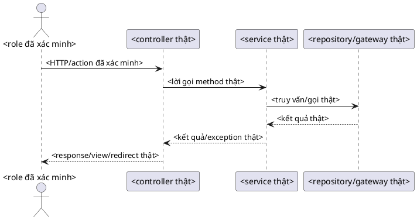

# Quy trình tái lập tiểu luận phần mềm

Tài liệu này là runbook theo thứ tự từ lúc nhận đề đến lúc bàn giao DOCX. Phần đầu áp dụng cho project mới; phần cuối ghi rõ lệnh riêng của bài StrongWine để không nhầm script mẫu với công cụ dùng chung. Đọc thêm `docs/course-essay-lessons.md` để tránh các lỗi đã xác nhận về registry citation, render binding và script snapshot. Quy trình WordAssistant này không gọi agy/Antigravity, n8n hay model provider.

## Sơ đồ luồng

```text
Đề bài + rubric + project nguồn
  → khóa phạm vi và nguồn chuẩn
  → khởi tạo workspace + manifest
  → kiểm chứng nội dung và route/template
  → lập figure/diagram plan
  → sinh wireframe + cây màn hình / vẽ UML từ source
  → soạn và định dạng DOCX bằng WordAssistant
  → cập nhật field trong Word, lưu bản mới
  → render mọi trang + xem bằng mắt + kiểm tra nội dung
  → lưu báo cáo QA và bàn giao đúng một bản final
```

Mỗi thay đổi DOCX sau khi render làm hết hiệu lực kết quả xem trang trước đó. Chạy lại render và xem lại các trang bị ảnh hưởng; với thay đổi cuối cùng, kiểm tra lại toàn bộ tài liệu.

## Bảng thứ tự, công cụ và đầu ra

| Bước | Công cụ | Đầu vào | Đầu ra / cổng qua bước |
|---|---|---|---|
| 1. Khóa nguồn | Đọc đề, rubric, tài liệu được giao; Git nếu project có Git | Đề môn học, rubric, DOCX mẫu được chỉ định, project nguồn | `project.json` ghi rõ nguồn chuẩn, nguồn chỉ tham khảo, revision và profile được phép dùng |
| 2. Tạo workspace | `scripts/init_course_essay_project.py` | Tên bài và đường dẫn chưa tồn tại | `project.json`, `requirements-matrix.csv`, `screen-inventory.json`, `figure-plan.csv`, `diagram-plan.csv`, `README.md` |
| 3. Kiểm tra môi trường | WordAssistant `doctor`, `capabilities`; PlantUML `doctor` nếu vẽ UML | Repo và máy hiện tại | JSON xác nhận backend thật sự hoạt động; năng lực thiếu được đánh dấu `NOT RUN` |
| 4. Lập chứng cứ | Đọc đúng controller, template, service/entity, rubric và nguồn trích dẫn liên quan | Manifest và source project chỉ đọc | Mỗi phát biểu/hình có file, symbol, route hoặc đoạn nguồn để kiểm lại |
| 5. Sinh wireframe và cây màn hình | `scripts/build_course_essay_assets.py build` cho Java Spring MVC có scanner; `render` cho framework khác sau khi người review kiểm source | `screen-inventory.json` đã đối chiếu với source | PNG wireframe, PNG cây phân rã, `.puml` cây, JSON report. `build` có thể báo scanner `PASS`; `render` báo `source_verification=NOT_RUN_MANUAL_REVIEW_REQUIRED` và không xác nhận route |
| 6. Vẽ UML chuyên môn | Viết `.puml` từ source rồi dùng `wordassistant plantuml render` | Bảng `diagram-plan.csv`, source code đã xác minh | `.puml` có thể sửa, PNG để đưa vào Word, đường dẫn source evidence đã ghi |
| 7. Soạn Word | WordAssistant CLI và Microsoft Word khi cần cập nhật field | Bản nội dung đã kiểm chứng, profile được đề yêu cầu, ảnh đã duyệt | DOCX mới, styles/fields có nghĩa trong Word, captions và danh mục liên kết đúng |
| 8. QA và bàn giao | WordAssistant `inspect`/`verify`/`render`, xem ảnh render từng trang | DOCX cuối đã lưu từ Word | QA JSON, PDF/ảnh render, checklist; không còn lỗi chưa xử lý hoặc ghi rõ `NOT RUN` |

## 1. Khóa phạm vi và nguồn chuẩn

Trước khi viết, phân loại tài liệu đầu vào:

- **Nguồn quyết định yêu cầu:** đề, rubric, hướng dẫn của giảng viên. Chỉ chọn profile trường khi đề hoặc người dùng nói rõ trường/profile đó.
- **Nguồn sự thật của project:** checkout/source project được người dùng chỉ định. Đọc source ở chế độ chỉ đọc; ghi commit hash nếu là Git (`git -C <project> rev-parse HEAD`).
- **Mẫu trình bày:** chỉ quyết định hình thức khi người dùng nói dùng mẫu đó; không lấy nội dung, tên trường, route hay quy định của bài mẫu làm dữ kiện cho bài mới.
- **Nguồn học thuật:** dùng tài liệu đã đọc và xác nhận đúng phiên bản/đoạn hỗ trợ nhận định. DOI hoặc kết quả tìm kiếm chỉ là đầu mối, chưa phải chứng cứ để trích dẫn. Quy trình chi tiết nằm ở `docs/academic-report-workflow.md`.

Không bịa tên, lớp, MSSV, chữ ký, duyệt, kết quả kiểm thử, số liệu, route, chức năng, bảng dữ liệu hoặc trích dẫn. Thiếu thông tin thì để ô cần điền hoặc ghi `NOT PROVIDED` trong workspace; không lấp bằng nội dung có vẻ hợp lý.

Thiếu rubric không tự biến một bản DOCX generic thành tiểu luận hoàn chỉnh. Có thể tạo bản nháp để người dùng xem, nhưng báo `word_delivery: PASS` riêng và giữ `submission_readiness: INCOMPLETE` cho tới khi yêu cầu môn học và các evidence bắt buộc được kiểm. Không gắn nhãn “đã hoàn tất/sẵn sàng nộp” chỉ vì Word render và verify pass.

## 2. Khởi tạo workspace mới

Từ thư mục gốc WordAssistant, chọn một thư mục output mới. Script từ chối ghi đè thư mục đã tồn tại:

```powershell
New-Item -ItemType Directory -Force artifacts\course-essay | Out-Null
\.venv\Scripts\python.exe scripts\init_course_essay_project.py `
  artifacts\course-essay\my-project `
  --title 'Tiểu luận: tên đã xác minh'
```

Parent folder phải tồn tại; destination `my-project` thì chưa được tồn tại. Script chép bộ khung từ `templates/course-essay-starter/` và chỉ điền title đã xác minh. Điền các file trong `artifacts/course-essay/my-project/`:

- `project.json`: title/course, assignment/rubric, source root/revision, danh sách reference chỉ đọc, profile (mặc định `null`), output DOCX, evidence registry, QA JSON và các cổng nghiệm thu.
- `requirements-matrix.csv`: từng yêu cầu ở rubric, vị trí trong đề, mục bài đáp ứng, evidence, trạng thái kiểm chứng và người có thẩm quyền nếu được miễn.
- `claim-evidence.csv`: claim ID, vị trí bài, evidence ID, đường dẫn/hash/vị trí nguồn và xác nhận review.
- `evidence.json`: registry nguồn cho các luận điểm cụ thể về project; mỗi ID phải nối với file source, hash và vị trí hỗ trợ trong `claim-evidence.csv`.
- `report-evidence.json`: WordAssistant registry cho citation học thuật nhìn thấy trong DOCX; chỉ chứa nguồn đã tải/đọc/review và được chèn vào bibliography.
- `integrity-warning-dispositions.csv`: quyết định riêng cho từng warning/finding.
- `screen-inventory.json`: view GET đã xác minh và định nghĩa wireframe nguồn-backed.
- `figure-plan.csv`: từng hình cần có, loại hình, nguồn, route/role/state, artifact và trạng thái xác minh.
- `diagram-plan.csv`: từng biểu đồ UML/ERD, câu hỏi biểu đồ trả lời, source files/symbols, `.puml`, PNG và trạng thái kiểm.
- `README.md`: hướng dẫn tại workspace và các placeholder phải hoàn tất.

Các trạng thái trong matrix: `PASS`, `NOT_RUN`, `BLOCKED`, `FAIL`, hoặc `WAIVED` kèm lý do và người có thẩm quyền. Không dùng `MET_AS_UNRESOLVED`; thiếu đề/rubric là `NOT_RUN` và chặn xác nhận rubric compliance.

Không sửa project nguồn để làm report. Tạo thư mục output riêng cho `content.json`, hai evidence registry, `.puml`, PNG, DOCX và QA reports. Không dùng registry citation học thuật để thay thế claim-to-source map của project: hai loại bằng chứng có mục đích và schema khác nhau. Không lưu credentials hoặc dữ liệu khách hàng vào workspace.

## 3. Kiểm tra môi trường và chọn cách làm Word

Trên môi trường mới chạy một lần:

```powershell
\.venv\Scripts\python.exe -m wordassistant.cli doctor --json
\.venv\Scripts\python.exe -m wordassistant.cli capabilities --json
```

Nếu cần UML, kiểm tra PlantUML trước khi viết nhiều sơ đồ:

```powershell
\.venv\Scripts\python.exe -m wordassistant.cli plantuml doctor --json
```

Chỉ tiếp tục với thao tác mà JSON báo khả dụng. WordAssistant core không cần API key. Nếu native Word, PlantUML, LibreOffice hay advanced Word backend không có, đừng giả vờ đã cập nhật field/render; dùng backend có thật hoặc ghi rõ `NOT RUN`. Các khả năng thay đổi theo máy, nên dùng kết quả doctor của lượt chạy chứ không copy trạng thái từ tài liệu này.

## 4. Kiểm chứng nội dung và lập manifest màn hình

### 4.1 Đọc source có mục tiêu

Đọc rubric trước để chốt chương/mục bắt buộc. Với project, lần theo route tới view/template rồi tới service/entity hoặc test chỉ khi nội dung bài cần hành vi đó. Ghi tương đối đường dẫn repo và tên symbol/method; đừng lấy tên file/route từ trí nhớ.

Manifest hiện tại của `build_course_essay_assets.py` tự dò các mapping Java Spring MVC `GET` trả HTML view và template tương ứng. Role key và tên hệ thống lấy từ inventory nên project có role khác vẫn có thể dùng cây màn hình; role key chỉ dùng chữ/số/`_`/`-`. Với framework khác, trước tiên xác minh adapter có hỗ trợ hay không. Không được dùng kết quả Java scanner như bằng chứng cho framework khác; khi không hỗ trợ, tự lập inventory có kiểm chứng và không báo script audit là đã xác minh.

`build` chỉ dùng khi source tương thích adapter Java Spring MVC hiện có. Với framework khác, hoàn tất kiểm source route/template bằng người review rồi gọi `render`; lệnh này kiểm cấu trúc inventory và vẽ ảnh nhưng không quét controller/template. Lưu report `RENDERED` cùng `source_verification=NOT_RUN_MANUAL_REVIEW_REQUIRED`; trạng thái đó không thay cho `VERIFIED_SOURCE` trong `figure-plan.csv`.

### 4.2 `screen-inventory.json`

`system_title` là tên sản phẩm/hệ thống hiển thị ở nút gốc. Mỗi phần tử `screens[]` đại diện cho **một view/template**, gồm:

- `id`: ID duy nhất của view; GET alias trả cùng view dùng chung ID.
- `label`: tên màn hình ngắn, người đọc hiểu được.
- `roles`: role thực sự có quyền/xem view; kiểm tra security/controller.
- `modules`: ánh xạ từng role tới nhóm chức năng để tạo cây phân rã.
- `routes`: các route `GET` trả HTML view; ghi method và path, ví dụ `GET /orders`.
- `controller`, `mapping_tokens`, `template`, `view_token`: đường dẫn và token đối chiếu trực tiếp với source.

Không đưa POST, API JSON, redirect-only handler, action của nút hay inline state thành page. Nếu vài GET alias về cùng view, lưu toàn bộ route trong một screen; builder đếm route riêng với view. Hãy bảo đảm mỗi role có nhóm chức năng, không để vai trò/route chỉ vì “thường ứng dụng nào cũng có”.

### 4.3 `figure-plan.csv`

Đây là sổ theo dõi chứng cứ hình, không phải nguồn sinh hình. Dùng `kind` nhất quán (`wireframe`, `runtime_screenshot`, `saved_project_capture`, `uml`, `screen_hierarchy`, `other`). Với screenshot ghi route, role, state, viewport, ngày chụp và đường dẫn nguồn. Với wireframe ghi route/template, trường/nút đang có và output PNG. `status` bắt đầu là `planned`; chỉ đổi sang `verified`/`captured`/`generated` sau khi nhìn và so với source. Không gọi ảnh cũ trong project là runtime capture mới.

### 4.4 Evidence registry và ký hiệu citation nội bộ

Mỗi citation trong bài phải được phân giải thành một record có nguồn, vị trí/đoạn hỗ trợ, ngày/version và trạng thái review; liên kết claim → record phải nhìn được trong bài hoặc trong evidence registry. `source_manifest.json` với đường dẫn/hash hữu ích cho provenance nhưng không thay bibliography/evidence registry. Ký hiệu `(S1)` chỉ hợp lệ nếu S1 trỏ đến record đã review và tài liệu có danh mục tương ứng. Nếu audit profile yêu cầu nguồn đã review mà registry không có, không lấy `source_evidence: PASS` từ generic profile làm bằng chứng thay thế.

## 5. Tạo wireframe đúng mẫu và cây phân rã màn hình

Chỉ chạy sau khi hoàn tất `screen-inventory.json` và khai báo `wireframes[]`. Cấu trúc một wireframe có `id`, `file`, `screen_ids`, `caption`, `screen_title`, `route` và `sections[]`. Mỗi section có thể chứa `title`, `text_items`, `fields`, `buttons`, `table_columns`/`rows`, `panels` hoặc `cards` — chỉ thêm mục có trong template thật.

Phong cách theo mẫu người dùng đã gửi: nền trắng, đường viền đen, nhãn thật, ô trống và tiêu đề bảng rõ. Wireframe là bản giản lược cấu trúc trang, không phải ảnh screenshot. Không thêm browser chrome, dữ liệu mẫu, khách hàng, giá, KPI, trạng thái hay control không có trong source. Giữ nguyên tên tiếng Việt/dấu. Chia wireframe theo màn hình/chức năng khi gom nhiều vùng làm chữ quá nhỏ.

Ví dụ lệnh (thay `D:\Projects\my-app` bằng project nguồn thật; inventory vẫn ở workspace của report):

```powershell
\.venv\Scripts\python.exe scripts\build_course_essay_assets.py build `
  --project-root 'D:\Projects\my-app' `
  --inventory artifacts\course-essay\my-project\screen-inventory.json `
  --wireframe-dir artifacts\course-essay\my-project\assets\wireframes `
  --diagram-dir artifacts\course-essay\my-project\assets\screen-hierarchy `
  --report artifacts\course-essay\my-project\reports\asset-build.json
```

**Input:** source root + manifest. **Output:** mỗi wireframe khai báo được ghi thành PNG theo `file`; cây màn hình cho từng role được ghi thành `screen_hierarchy_<role>.png` và `.puml`; JSON report nêu route/view đã tìm thấy, file đã tạo và lỗi. PNG wireframe hiện dùng canvas 1800×1400; cây màn hình rộng 1600 px và chiều cao phụ thuộc số node. Nếu report lỗi, sửa manifest/source mismatch; không nới kiểm tra để ép build pass.

Builder chỉ audit route/view trong phạm vi Java Spring MVC scanner hiện có. Nó không tự sinh UML class/activity/sequence/use-case, không chụp ứng dụng đang chạy, không nhúng hình vào DOCX và không thay QA mắt. Nó tạo một cây cho mỗi role có trong inventory, dùng `system_title` ở gốc. Xem từng PNG ở 100% và ở kích thước dự kiến trên trang Word: đủ chữ, đúng nhãn/quan hệ, không bị sát mép/cắt; so với HTML template thật. Cây màn hình đúng ba tầng `hệ thống → nhóm chức năng → màn hình`, dùng tên ngắn để dễ đọc. Route chính xác để ở inventory/report; không nhét path dài vào box nếu làm rối sơ đồ.

Khi route đã được kiểm thủ công hoặc framework chưa có adapter, dùng chế độ render-only:

```powershell
\.venv\Scripts\python.exe scripts\build_course_essay_assets.py render `
  --inventory artifacts\course-essay\my-project\screen-inventory.json `
  --wireframe-dir artifacts\course-essay\my-project\assets\wireframes `
  --diagram-dir artifacts\course-essay\my-project\assets\uml `
  --report artifacts\course-essay\my-project\qa\asset-render.json
```

Chế độ này nhận cùng schema inventory (`screens[]`, `roles`, `modules`, `routes`, `wireframes[].sections`) và tạo PNG wireframe theo `file`, cùng `screen_hierarchy_<role>.png`/`.puml`. Hierarchy PNG được vẽ bằng Pillow; `.puml` là bản mô tả tương đương để sửa hoặc render riêng, không phải input trực tiếp của PNG đó. Nó kiểm ID, route khai báo là GET, mối liên hệ screen/wireframe và cấm trường dữ liệu mẫu; nó **không** đọc source controller/template. Report phải giữ nguyên `source_verification=NOT_RUN_MANUAL_REVIEW_REQUIRED`. Chỉ người review đã đối chiếu route, handler, template và control mới được đánh dấu hình `VERIFIED_SOURCE`.

## 6. Vẽ UML: input, quy tắc nguồn và output

PlantUML **render** source; nó không khám phá hệ thống và không xác nhận sự thật của sơ đồ. Người vẽ phải đọc source, ghi evidence trong `diagram-plan.csv`, viết `.puml`, rồi render PNG. `.puml` là source of truth có thể sửa; PNG là output được nhúng vào Word. Thay `.puml` thì render lại PNG.

| Loại | Câu hỏi sơ đồ trả lời | Input phải lấy từ project | Không được tự suy diễn |
|---|---|---|---|
| Use case | Actor/role nào thực hiện chức năng nào trong phạm vi nào? | Rubric/phạm vi; role và quyền từ security config; chức năng từ route/controller/template | Actor ngoài hệ thống, quyền, chức năng không có chứng cứ |
| Class/domain | Những lớp/entity nào liên hệ với nhau? | Class/entity thật, field/association, kế thừa; lấy từ source, migration/schema khi cần | Class, thuộc tính, cardinality hoặc quan hệ “cho hợp UML” |
| Activity | Quy trình có nhánh, điều kiện và kết thúc nào? | Thứ tự xử lý và nhánh lỗi/điều kiện từ service/controller/validation/test | Nhánh không có trong code hoặc rubric |
| Sequence | Request đi qua các thành phần/method theo thứ tự nào? | Route/controller method, lời gọi service, repository/gateway, return/error path đã đọc trong code | Lifeline, tên method hay response dựa trên phỏng đoán |
| ERD (nếu đề yêu cầu) | Dữ liệu nào được lưu và liên kết ra sao? | Entity + annotation, migration/schema hiện hành; kiểu, khóa, nullability và cardinality | Cột/kiểu/khóa/cardinality không được source xác nhận |

Mỗi dòng `diagram-plan.csv` phải ghi `diagram_type`, mục tiêu/câu hỏi, `source_files`, `evidence_symbols_or_methods`, tên source `.puml`, PNG output, vị trí dự định trong bài và trạng thái. Dùng đường dẫn tương đối trong workspace; dùng dấu `;` để ngăn cách nhiều source nếu cần. Bản mẫu không chứa project facts.

Ví dụ skeleton sequence — chỉ là khung để thay bằng tên và message đã đọc ở source, không phải sơ đồ của mọi project:



Thay toàn bộ `<...>` trước khi render. Ví dụ render một file:

```powershell
\.venv\Scripts\python.exe -m wordassistant.cli plantuml render `
  artifacts\course-essay\my-project\diagrams\order-sequence.puml `
  --output artifacts\course-essay\my-project\assets\uml\order-sequence.png `
  --format png --json
```

**Input:** `.puml` đã đối chiếu. **Output:** PNG ở `--output` và JSON status. Nếu parser báo lỗi, sửa source. Nếu PNG quá cao/rộng, font nhỏ hoặc chữ/cạnh bị cắt khi đặt vừa trang, rút gọn nội dung có chứng cứ hoặc chia thành sơ đồ riêng; không bóp méo ảnh. Xem PNG độc lập và xem lại trang Word sau khi chèn. Lưu cả `.puml` và PNG để lần sau sửa tiếp được.

## 7. Chụp screenshot ứng dụng thật

Chỉ chụp runtime khi app thực sự chạy và bài cần chứng minh giao diện thật. Mở đúng URL/route, đăng nhập role được phép với dữ liệu demo an toàn, chuyển đến state cần minh họa, chọn viewport phù hợp, chụp toàn vùng cần chứng minh và xác nhận chữ/nút không mờ. Ghi URL/route, role, state, viewport, ngày, source project revision và đường dẫn ảnh trong `figure-plan.csv`. Không để lộ tài khoản/token, dữ liệu cá nhân hoặc cửa sổ khác. Nếu không chạy được app, dùng wireframe/saved capture được gắn nhãn đúng; đừng biến một loại ảnh thành loại khác.

## 8. Soạn và dàn trang DOCX

### Bài mới

Viết nội dung dựa trên requirement/evidence matrix và các source đã kiểm chứng. Với WordAssistant, kiểm tra command/profile đang có bằng `profiles` rồi tạo bản nháp mới; ví dụ theo CLI hiện hành:

```powershell
\.venv\Scripts\python.exe -m wordassistant.cli create `
  artifacts\course-essay\my-project\draft.docx `
  --profile generic --title 'Tiểu luận: tên đã xác minh' --json
```

Nếu dùng `compose`, soạn một `content.json` UTF-8 và registry chứng cứ riêng, rồi tạo output khác:

```powershell
\.venv\Scripts\python.exe -m wordassistant.cli compose `
  artifacts\course-essay\my-project\draft.docx `
  --output artifacts\course-essay\my-project\authored.docx `
  --content artifacts\course-essay\my-project\content.json `
  --evidence artifacts\course-essay\my-project\report-evidence.json --json
```

`compose --evidence` always receives `report-evidence.json`, because the citations it inserts must be validated against WordAssistant's reviewed-source schema. Keep project-source findings in `evidence.json` and `claim-evidence.csv`; do not merge the two schemas.

`generic` không phải rubric môn học. Nếu đề yêu cầu mẫu trường cụ thể, chọn profile tương ứng chỉ sau khi xác nhận nó khớp hướng dẫn; nếu profile không có, giữ style Word có thể sửa và báo validation theo profile là `NOT RUN`.

### Sửa DOCX có sẵn

Chạy inspect trước. File trên 40 trang hoặc không rõ độ dài thì dùng `--summary`; lấy text theo section/query giới hạn, không đổ toàn văn vào context. Chỉ sửa một bản copy, dùng heading/text selector chính xác. Không thay mọi chuỗi trùng trên toàn tài liệu khi chỉ muốn sửa một vị trí.

```powershell
\.venv\Scripts\python.exe -m wordassistant.cli inspect input.docx --summary --json
```

Giữ Word semantics: Heading styles thật, section properties, page-number field, caption `SEQ`, TOC/list-of-figures/list-of-tables fields và table properties. Tạo caption bằng Word caption workflow/field thay cho gõ số cố định; dựng lại danh mục hình/bảng từ đúng caption label. Chèn hình cạnh phần phân tích tương ứng, có caption ngắn, tên loại hình chính xác và alternative text khi có thể. Không dùng bảng bố cục cho bìa nếu mẫu không yêu cầu.

## 9. Cập nhật field, render và kiểm tra

1. Lưu Word ra một output DOCX mới. Trong Microsoft Word, cập nhật tất cả field, TOC, danh mục hình/bảng và số trang; repaginate rồi Save. Nếu native Word không có, ghi rõ backend thay thế và giới hạn.
2. Chạy verify đầu tiên để tạo render artifacts và visual-review challenge. Thay `PROFILE` bằng profile đã được đề cho phép; bỏ `--profile` nếu không có profile phù hợp. Dùng `--delivery` để lệnh trả trạng thái delivery:

   ```powershell
   \.venv\Scripts\python.exe -m wordassistant.cli verify output.docx `
     --native-fields --render --engine word --delivery `
     --report-output artifacts\course-essay\my-project\qa\verify-challenge.json --json
   ```

3. Mở **mọi** đường dẫn `render.page_images` trong report challenge. Không chỉ xem contact sheet. Kiểm tra bìa và trang cận bìa, tiêu đề/căn giữa, khung bìa, header/footer, số trang, text màu xanh ngoài ý muốn, ký tự/dấu tiếng Việt, chữ giãn bất thường, dòng rơi, caption, bảng, ảnh méo/cắt và trang trắng. Mở riêng trang có sơ đồ/wireframe để đọc nhãn ở kích thước trang.
4. Chỉ sau khi đã xem hết ảnh, lấy token `visual_review_challenge.token` từ report và chạy lại cùng verify với `--visual-reviewed --visual-review-token <token>`. Token gắn với hash trang đã render; nếu sửa DOCX thì render lại và xin challenge/token mới. Không đặt `--visual-reviewed` trước khi đã xem mọi trang.
5. Đối chiếu nội dung hình lần cuối với route/template/class/method được ghi trong manifest. Nếu sửa bất cứ thứ gì, quay lại cập nhật field, lưu, chạy verify/render và xem lại.
6. Chạy `validate` chỉ với profile/rubric đã chọn. `validate.valid == true` và `verify.delivery_status == PASS` chỉ đặt `word_delivery: PASS`; chúng không kiểm tra tính đúng của luận điểm, nguồn luật, citation, UML hay việc tuân thủ rubric môn học.
7. Duyệt từng hàng requirements matrix, từng citation/evidence mapping và từng integrity warning. Dùng `PASS` chỉ khi evidence đã mở/đọc và hỗ trợ claim; dùng `NOT_RUN`/`BLOCKED` nếu rubric, registry hoặc kiểm chứng bắt buộc chưa có. Warning heuristic được phân loại và xử lý, không được im lặng bỏ qua.
8. Đặt `submission_readiness: PASS` chỉ khi mọi yêu cầu đã áp dụng được chứng minh bằng evidence và mọi cổng bắt buộc pass/waive hợp lệ. Nếu thiếu rubric hoặc còn nguồn/citation chưa review, `submission_readiness: INCOMPLETE`; được bàn giao như bản nháp/provisional, không gọi là tiểu luận sẵn sàng nộp.
9. Ghi report QA JSON, lệnh chạy, hash SHA-256 của DOCX cuối, profile đã dùng, các điểm `PASS`/`NOT_RUN`/`BLOCKED` và trạng thái readiness riêng. Giữ đúng một file mang tên final khi đã đủ điều kiện; giữ source `.puml`, manifest, report QA và DOCX input cần thiết. Không xóa source/evidence để “dọn gọn” nếu chưa xác nhận chúng không còn cần.

Các lệnh WordAssistant thường dùng (chạy `--help` nếu phiên bản CLI khác):

```powershell
\.venv\Scripts\python.exe -m wordassistant.cli inspect output.docx --summary --json
\.venv\Scripts\python.exe -m wordassistant.cli verify output.docx --json
\.venv\Scripts\python.exe -m wordassistant.cli verify output.docx --native-fields --render --engine word --delivery --json
\.venv\Scripts\python.exe -m wordassistant.cli render output.docx --engine word --outdir artifacts\course-essay\my-project\qa\render --json
```

Lần verify đầu trả `visual_review_challenge.token`; sau khi mở mọi `page_images`, lặp lại cùng lệnh với `--visual-reviewed --visual-review-token TOKEN`. `--visual-reviewed` là attestation gắn token, không tự kiểm tra pixel. Luôn mở ảnh từ đúng lần render cuối.

## 10. StrongWine đã làm: nguồn, lệnh và khác biệt riêng

Phần này ghi trạng thái của bài hiện tại, không phải giá trị mặc định cho project khác:

- DOCX đầu vào chỉ đọc: `artifacts/strongwine_course_essay_final_checked_v2.docx`.
- Project nguồn chỉ đọc: `D:\Projects\strongwine_2\Wine-website`.
- Inventory đã kiểm chứng: `examples/strongwine-course-essay/screen-inventory.json`.
- DOCX đạt yêu cầu người dùng: `artifacts/strongwine_course_essay_final_checked_v3.docx`.
- Lỗi và biện pháp phòng ngừa đã xác nhận: `docs/strongwine-course-essay-lessons.md`.

Làm mới wireframe và cây phân rã từ source StrongWine:

```powershell
\.venv\Scripts\python.exe scripts\build_course_essay_assets.py build `
  --project-root 'D:\Projects\strongwine_2\Wine-website' `
  --inventory examples\strongwine-course-essay\screen-inventory.json `
  --wireframe-dir artifacts\strongwine-oop-essay\wireframes_lowfi `
  --diagram-dir artifacts\strongwine-oop-essay\plantuml_overhaul `
  --report artifacts\strongwine-oop-essay\wireframe-build-report.json
```

Manifest StrongWine đã ghi các view/route của project; số lượng trong report phản ánh revision nguồn đã đọc, không copy số lượng đó sang project khác. Cây dùng đúng mẫu ba tầng và đặt tên screen trong box; route path đầy đủ ở manifest/report.

`scripts/strongwine_course_essay.py` và `scripts/run_strongwine_course_essay_qa.ps1` là helper dành riêng cho DOCX StrongWine hiện tại: audit nội dung/hình với project, prepare/update visuals, sửa caption sequence đã được xem xét, khôi phục byte ảnh sau khi Word lưu, cập nhật field bằng Word COM, chạy inspect/page-number và render. Wrapper nhận đúng một trong `-Prepare`, `-UpdateVisuals`, `-RepairCaptionSequence`; mỗi mode yêu cầu input/output phù hợp và từ chối overwrite output. Các anchor, caption, trang kiểm và wireframe hiện gắn với bài StrongWine, nên không chạy wrapper này cho bài khác nếu chưa thay toàn bộ cấu hình có chủ đích.

Ví dụ refresh hình trong một bản sao khác của bài StrongWine:

```powershell
\.\scripts\run_strongwine_course_essay_qa.ps1 `
  -InputDocx artifacts\strongwine_course_essay_final_checked_v2.docx `
  -OutputDocx artifacts\strongwine_course_essay_final_checked_v3.docx `
  -ProjectRoot 'D:\Projects\strongwine_2\Wine-website' `
  -UpdateVisuals
```

QA helper tạo JSON/log trong thư mục timestamp và preview trang từ PDF render; command/report là chứng cứ của lần chạy cụ thể. Nếu thay DOCX sau đó thì phải chạy lại QA. Một bài khác cần wrapper tổng quát riêng hoặc thao tác chuẩn WordAssistant nêu ở trên, không đổi path/title rồi kỳ vọng wrapper tự hiểu bài.

## Regression và điều kiện dừng

Nếu thay builder/manifest/logic sửa DOCX, chạy focused tests trước và full suite một lần sau khi source ổn định:

```powershell
\.venv\Scripts\python.exe -m pytest tests\test_course_essay_assets.py tests\test_strongwine_course_essay.py -q
\.venv\Scripts\python.exe -m pytest -q
```

Dừng trước khi tuyên bố sẵn sàng nộp nếu route/view chưa khớp source, sơ đồ còn placeholder, figure không có provenance, ảnh bị crop/chữ không đọc được, caption/danh mục sai, source/citation chưa review, integrity warning chưa được disposition, rubric thiếu, hoặc một check bắt buộc đang `NOT_RUN`. Có thể bàn giao DOCX đã render như bản nháp, nhưng phải ghi rõ `word_delivery: PASS` và `submission_readiness: INCOMPLETE`.

### Cổng readiness tự động, chỉ đọc

Trong `project.json`, khai báo đường dẫn tương đối tới DOCX cuối, rubric/đề, requirements matrix, claim-evidence, project registry `evidence.json`, citation registry `report_citation_registry_file`, verify JSON cuối, integrity-audit JSON cuối và warning-dispositions CSV. Lưu nguyên JSON stdout của WordAssistant; không sửa report để làm cho cổng qua. Verify phải có `delivery_status: PASS`, `overall_status: PASS`, `render_status: PASS`, `visual_status: PASS` và `render.document_sha256` trùng hash DOCX. Nếu chọn profile thì lưu cả `wordassistant validate OUTPUT --profile ID --variant VARIANT --json` tại `qa/profile-validation.json`; `validate.valid` phải là `true`, còn `verify.format_status` phải là `PASS`, cùng đúng profile/variant/file. Integrity audit phải có `document.sha256` trùng hash DOCX, hash `report-evidence.json` trùng `report_citation_registry_file` và `source_evidence: PASS`.

`claim-evidence.csv` ghi một hàng cho mỗi claim project cần chứng minh, gồm claim/evidence ID, vị trí trong bài, đường dẫn nguồn, SHA-256, vị trí đoạn hỗ trợ, `review_status=reviewed`, `support_confirmed=yes`, người review và ngày. Mỗi `evidence_id` phải tồn tại trong `evidence.json`, có trạng thái reviewed và cùng source SHA-256/vị trí hỗ trợ. Các citation nhìn thấy như `[1]`–`[n]` phải tồn tại trong `report-evidence.json` và bibliography Word. Chạy `wordassistant integrity audit ... --evidence report-evidence.json`; không truyền project claim registry vào lệnh này vì nó không phải bibliography registry.

Readiness kiểm riêng hai việc: claim project phải khớp `evidence.json`; integrity audit phải được hash-bind tới `report-evidence.json` qua `project.json.report_citation_registry_file`. Khi audit có `numeric_citation_bibliography_consistency.citation_numbers`, checker so lượng ID citation được audit liên kết với số citation khác nhau trong DOCX. Nếu report cũ không có danh sách số citation, checker dùng phép đối chiếu claim-ID tương thích ngược. Nếu dùng nhãn nội bộ `(S1)`–`(S8)` trong bài, vẫn phải có hàng tương ứng trong claim map và một danh mục nguồn project mà người đọc thấy được; một file QA nội bộ tự nó không phải citation hiển thị.

Trong `requirements-matrix.csv`, `evidence_files` là danh sách đường dẫn file phân tách bằng dấu chấm phẩy; mỗi file phải tồn tại. Không để yêu cầu ở trạng thái trống, `NOT_RUN`, `BLOCKED` hoặc `FAIL`. Waiver cần lý do, verification và `waived_by` trong hàng.

Mỗi gate `WARN` trong integrity audit cần một hàng `integrity-warning-dispositions.csv` theo đúng tên gate và `finding_index` bắt đầu từ 1. `decision` chỉ nhận `accepted` hoặc `not_applicable`; ghi lý do, bằng chứng, reviewer và ngày. Cổng không cho phép disposition vượt qua `source_evidence` đang WARN/FAIL; sửa mapping rồi chạy lại integrity audit.

Tám mục trong `required_acceptance_checks` là cổng review thủ công bắt buộc: đã đọc đề/rubric, map claim/evidence, disposition warning, đối chiếu route/template, phân biệt wireframe/runtime capture, cập nhật danh mục hình, cập nhật/lưu Word fields và xem mọi trang render cuối. `true` là xác nhận của người review, không phải kết quả tự suy ra của script. Ghi evidence vào matrix, figure/diagram plan hoặc QA report; nếu một mục không áp dụng, ghi rõ lý do trước khi đánh dấu hoàn tất.

Chạy từ thư mục gốc WordAssistant sau khi DOCX cuối và hai report QA đã cố định:

```powershell
\.venv\Scripts\python.exe scripts\check_course_essay_readiness.py artifacts\course-essay\my-project
```

Script chỉ đọc workspace và in một JSON report ra stdout, gồm `word_delivery`, `content_and_sources`, `submission_readiness`, từng check, lý do, đường dẫn DOCX và SHA-256. Nó không sửa project, report QA hay DOCX. Exit code `0` nghĩa readiness `PASS`, `1` nghĩa còn `INCOMPLETE`, `2` nghĩa có lỗi cứng `FAIL`. Lưu stdout nếu cần artifact bền vững, ví dụ `... > artifacts\course-essay\my-project\qa\readiness.json`; giữ stderr riêng.

Ví dụ khi kiểm tra Word đã qua nhưng đề và nguồn chưa đủ:

```text
word_delivery: PASS
content_and_sources: INCOMPLETE — rubric chưa có; các claim (S1)–(S8) chưa nối tới evidence đã review.
submission_readiness: INCOMPLETE — bàn giao bản nháp, chưa xác nhận sẵn sàng nộp.
```

Kết quả của checker chỉ xác nhận các cổng và file đã khai báo; người review vẫn phải mở/đọc nguồn để xác nhận đoạn nguồn thực sự hỗ trợ luận điểm. Không gọi bài sẵn sàng nộp nếu matrix/claim evidence sai, dữ liệu kê khai không trung thực, hoặc rubric/nguồn bắt buộc chưa được cung cấp.

## Checklist bàn giao nhanh

- [ ] Đề/rubric và source authority được ghi; school profile chỉ dùng khi đề yêu cầu.
- [ ] Mọi claim project, route, role, template và UML đều truy ngược được đến source.
- [ ] `evidence.json` chỉ được dùng cho project claim map; `report-evidence.json` chỉ được dùng cho citation trong Word và integrity audit.
- [ ] Wireframe theo mẫu trắng/đen, dữ liệu trống; screenshot runtime được ghi route/role/state/viewport/ngày.
- [ ] `.puml` và hình output cùng được lưu; diagram plan có source và câu hỏi biểu đồ trả lời.
- [ ] Caption và danh mục được cập nhật thành Word fields; layout được kiểm ở Word.
- [ ] Mọi trang của đúng DOCX cuối đã được mở xem sau render cuối.
- [ ] Citation/claim có evidence đã review; mọi integrity warning có disposition.
- [ ] Word delivery và academic submission readiness được báo riêng; không còn cổng bắt buộc `NOT_RUN` để gọi là sẵn sàng nộp.
- [ ] Báo hash, commands, QA reports, PASS/NOT RUN/BLOCKED và chỉ một final output khi đã đủ điều kiện.
- [ ] Lỗi phát sinh mới chỉ được thêm vào lessons sau khi đã xác nhận nguyên nhân và cách phòng ngừa.
